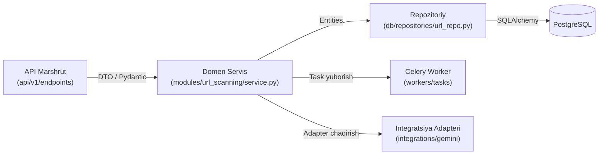

# 02. Komponentlar Chegarasi va Mas'uliyatlar Taqsimoti (Component Boundaries)

## 1. Kirish va Maqsad

Ushbu hujjat backend loyihasidagi modullar va komponentlar oʻrtasidagi arxitekturaviy chegaralarni (boundaries), maʼlumotlar uzatish qoidalarini hamda har bir qatlamning aniq mas'uliyat doirasini belgilaydi. 

Loyiha xavfsizlikka yoʻnaltirilgan boʻlgani sababli, kodning chalkashib ketishi (spaghetti architecture), qatlamlararo qoidabuzarliklar va ruxsatsiz toʻgʻridan-toʻgʻri chaqiruvlar qatʼiyan taqiqlanadi.

---

## 2. Loyiha Qatlamlari va Katalog Chegaralari

Tizim kod bazasi quyidagi asosiy qatlamlarga boʻlingan:

```text
app/
├── api/            # 1. API Qatlami (HTTP Request / Response, Marshrutlash)
├── core/           # 2. Yadro Qatlami (Konfiguratsiya, Xavfsizlik, Logging, Xatoliklar)
├── db/             # 3. Ma'lumotlar Bazasi Qatlami (Sessiyalar, Base modellar, Repozitoriylar)
├── modules/        # 4. Domen Modullari Qatlami (Asosiy Biznes Mantiq)
├── integrations/   # 5. Tashqi Integratsiyalar Qatlami (Telethon, Bot, Gemini, Whois)
└── workers/        # 6. Fon Vazifalari Qatlami (Celery Tasklar va Orkestratsiya)
```

Quyidagi jadvalda har bir qatlamning ruxsat etilgan va taqiqlangan mas'uliyatlari koʻrsatilgan:

| Qatlam | Mas'uliyati | Qat'iy Taqiqlangan Ishlar |
| :--- | :--- | :--- |
| **`api/`** | HTTP soʻrovlarni qabul qilish, Pydantic orqali validatsiya qilish, status kodlarini qaytarish. | Biznes mantiq yozish, toʻgʻridan-toʻgʻri tashqi saytlarga HTTP soʻrov joʻnatish, SQL soʻrovlar yozish. |
| **`core/`** | Butun tizim uchun umumiy konfiguratsiya (`config.py`), kriptografiya primitivlari (`security.py`), global xatoliklar. | Domen modullariga yoki API endpointlariga bogʻlanib qolish (circular imports). |
| **`db/`** | SQLAlchemy sessiyalarini boshqarish, tranzaksiyalar, umumiy CRUD va Repozitoriy shablonlari. | Xizmatlararo biznes qarorlar qabul qilish. |
| **`modules/`** | Foydalanuvchilar, chatlar, URL skanerlash, tahdid baholash, xavf mantiqi. | HTTP request/response obyektlariga bevosita tayanish, FastAPI obyektlarini import qilish. |
| **`integrations/`** | Tashqi API va kutubxonalar (Telethon, Gemini SDK, python-telegram-bot, DNS/WHOIS) bilan muloqot qiluvchi adapterlar. | Domen modellarini toʻgʻridan-toʻgʻri oʻzgartirish yoki biznes mantiqni oʻz ichiga olish. |
| **`workers/`** | Asinxron/ogʻir vazifalarni (URL tekshirish, sun'iy intellekt, xabarnomalar) fon rejimida bajarish. | API marshrutlarini chaqirish, uzoq muddatli tranzaksiyalarni ochiq qoldirish. |

---

## 3. Qat'iy Arxitekturaviy Qoidalar

### 3.1 Biznes mantiqni Marshrutlarda (Routes) Yozmaslik
* FastAPI marshrutlari (endpoints) juda "yupqa" (thin controllers) boʻlishi shart.
* Marshrutning yagona vazifasi:
  1. Kiruvchi maʼlumotni Pydantic modeliga mosligini tekshirish.
  2. Autentifikatsiya qilingan foydalanuvchini olish (`Depends(get_current_user)`).
  3. Tegishli servisni (Service Layer) chaqirish.
  4. Javobni (Response Schema) qaytarish.
* Hech qachon marshrut ichida kriptografik amallar, URL skanerlash yoki tashqi tarmoq soʻrovlari yozilmaydi.

### 3.2 Telegram Hodisa Tinglovchilarida (Event Handlers) Ogʻir Mantiq Yozmaslik
* Telethon'ning `Events.NewMessage` tinglovchisi soniyasiga oʻnlab xabarlarni qabul qilishi mumkin.
* Agar hodisa ichida toʻgʻridan-toʻgʻri URL skanerlansa yoki Gemini chaqirilsa, Telegram MTProto oqimi bloklanadi (freeze) va FloodWait xatoligi yuzaga keladi.
* **Toʻgʻri yoʻl:** Telethon hodisasida faqat URL-lar ajratib olinadi va Celery vazifasiga (`scan_url_task.delay(...)`) topshiriladi.

---

## 4. Sinxron va Asinxron Ma'lumotlar Bazasi Strategiyasi

Loyiha ikkita asosiy ishchi rejimdan iborat:
1. **Asinxron rejim (FastAPI va Telethon):** Yuqori unumdorlik uchun `asyncio` va `asyncpg` ishlatiladi.
2. **Sinxron/Asinxron fon ishchilari (Celery Workers):** Celery anʼanaviy ravishda koʻp oqimli (prefork/threads) ishlagani sababli, Celery tasklarida maxsus ajratilgan sessiyalardan foydalaniladi.

### Qoidalar:
- **Hech qachon bitta SQLAlchemy sessiyasini bir nechta oqim yoki tasklar oʻrtasida taqsimlamang!**
- Har bir HTTP soʻrov oʻzining alohida `AsyncSession` obyektiga ega boʻladi va soʻrov tugagach yopiladi (`yield` kontekst menejeri orqali).
- Har bir Celery vazifasi oʻzining alohida kontekstli bazaga ulanish sessiyasini ochadi va vazifa yakunida sessiyani yopadi (`try ... finally session.close()`).

---

## 5. Repozitoriy va Servis Qatlami (Repository & Service Pattern)

Maʼlumotlar bazasi va domen mantigʻini toʻliq ajratish uchun quyidagi qatlamlar zanjiridan foydalaniladi:



* **Repozitoriy (Repository):** Faqat maʼlumotlar bazasiga murojaat qilish (CRUD, filtrlash, qidirish) uchun javobgar. U yerda xavfsizlik qarorlari yoki AI mantigʻi boʻlmaydi.
* **Servis (Service):** Domen mantigʻini jamlaydi: masalan, "URL-ni bazadan qidirish, agar topilmasa, SSRF tekshiruvidan oʻtkazish, Redis keshiga yozish va tahlil vazifasini ishga tushirish".

---

## 6. Integratsiyalarni Izolyatsiya Qilish (Adapter Pattern)

Tashqi SDK va kutubxonalar (masalan, Google GenAI SDK, Telethon, Whois kutubxonalari) toʻgʻridan-toʻgʻri domen modullariga aralashmasligi kerak. Ular `app/integrations/` papkasida interfeyslar (Adapter) ortida yashiriladi.

**Nima uchun bu muhim?**
1. Agar ertaga Google Gemini SDK versiyasi yangilansa yoki boshqa AI provayderi (masalan, Claude yoki mahalliy LLM) qoʻshilsa, faqat bitta adapter oʻzgartiriladi, butun domen kodi buzilmaydi.
2. Unit testlarda tashqi servislar (Gemini, Telegram API) osonlik bilan "Mock" qilinadi.
