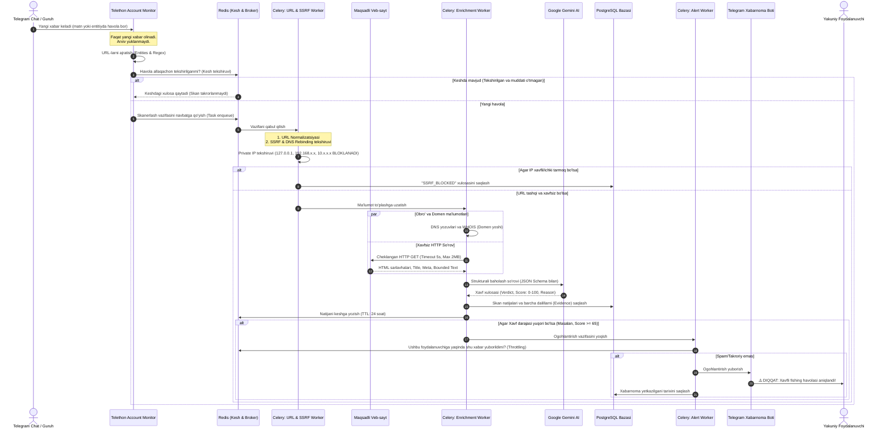

# 03. Ma'lumotlar Oqimi (End-to-End Data Flow)

## 1. Kirish va Maqsad

Ushbu hujjat tizimda maʼlumotlarning harakatlanish zanjirini bosqichma-bosqich yoritadi: Telegram xabari qabul qilingan paytdan boshlab, havolalarni ajratib olish, xavfsizlik filtrlari, tashqi tahlillar, sun'iy intellekt xulosasi va foydalanuvchiga ogohlantirish yetkazilgunga qadar boʻlgan toʻliq sikl.

---

## 2. Toʻliq Ketma-ketlik Diagrammasi (Sequence Diagram)

Quyidagi diagrammada tizimning barcha ishtirokchi qismlari oʻrtasidagi maʼlumotlar oqimi keltirilgan:

---

## 3. Bosqichma-bosqich Tahlil Jarayoni

### 1-bosqich: Xabarni Tutib Olish va Havolalarni Ajratish
* Telethon mijozi `events.NewMessage` hodisasini qabul qiladi.
* Xabardan barcha havolalar quyidagi manbalardan olinadi:
  1. `MessageEntityUrl` — ochiq yozilgan havolalar (masalan: `https://example.com`).
  2. `MessageEntityTextUrl` — matn ostiga yashiringan havolalar (masalan: `[bu yerga bosing](https://phishing-site.com)`).
  3. Matn ichidagi qidiruv (Regex yordamida kiritilgan havolalar).
* Har bir havola umumiy kanonik koʻrinishga (canonical form) keltiriladi:
  * Katta-kichik harflar bir xillashtiriladi (domen qismida).
  * URL oxiridagi keraksiz treking parametrlar (`utm_source`, `fbclid`, `gclid`) tozalanadi.
  * Punycode (IDN homografik hujumlar) tahlil qilinadi (masalan, `xn--...` koʻrinishiga oʻtkaziladi).

### 2-bosqich: Takrorlanishni Tekshirish va Kesh (Deduplication)
* Havolaning SHA-256 heshi hisoblanadi.
* Redis'dan `scanned_urls:hash` kaliti tekshiriladi.
* Agar havola oxirgi 24 soat ichida toʻliq skan qilingan boʻlsa va bazada yangi xulosa mavjud boʻlsa, qayta ogʻir tarmoq va AI soʻrovlari yuborilmaydi (keshdagi natijadan foydalaniladi).

### 3-bosqich: SSRF va Tarmoq Xavfsizligi Tekshiruvi
* **Kiberxavfsizlik talabi:** Foydalanuvchi taqdim etgan URL orqali bizning serverimiz ichki tarmoqlarini (AWS metadata, localhost, 127.0.0.1, 10.0.0.0/8, 172.16.0.0/12, 192.168.0.0/16) skan qilishiga yoʻl qoʻyilmasligi shart.
* Havola domeni DNS orqali IP manzilga yechiladi (Resolve).
* Olingan barcha IP-lar qora roʻyxatdan (Private/Loopback/Link-local IP) tekshiriladi. Agar ichki tarmoqqa tegishli boʻlsa, soʻrov darhol toʻxtatiladi va xavfli hodisa sifatida qayd etiladi.

### 4-bosqich: Tashqi Tahlil va Dalillarni Toʻplash (Enrichment)
Xavfsiz deb topilgan tashqi URL boʻyicha quyidagi dalillar (evidence) toʻplanadi:
1. **Domen va DNS maʼlumotlari:**
   * Domen roʻyxatdan oʻtgan sana (agar yaqinda ochilgan boʻlsa, fishing ehtimoli yuqori).
   * A, MX, NS, TXT yozuvlari mavjudligi.
2. **SSL/TLS Sertifikati:**
   * Emitent (Let's Encrypt, Cloudflare, etc.).
   * Sertifikat amal qilish muddati va Common Name.
3. **HTTP Javobi (Bounded Fetch):**
   * HTTP status kodi (200, 301, 302, 404).
   * Yoʻnaltirishlar (Redirects) zanjiri — havola boshqa xavfli domenga yoʻnaltiryaptimi?
   * Sahifa HTML kodidan: Title, Meta description, Favicon havolasi, forma va inputlar mavjudligi (`type="password"` bormi?).
   * HTML sahifadagi matn (faqat dastlabki 50-100 KB matn olinadi, ortiqcha maʼlumotlar xotiradan tozalanadi).

### 5-bosqich: Sun'iy Intellekt Tahlili (Google Gemini)
* Yigʻilgan barcha dalillar (domen yoshi, sertifikat, redirect zanjiri, sahifa sarlavhasi va matni) strukturali prompt koʻrinishida Gemini API'ga yuboriladi.
* Gemini erkin matn emas, balki qatʼiy **JSON Schema** boʻyicha javob qaytaradi:
  * `verdict`: `PHISHING` | `SCAM` | `SUSPICIOUS` | `BENIGN` | `UNKNOWN`
  * `risk_score`: 0 dan 100 gacha son.
  * `confidence`: 0.0 dan 1.0 gacha ishonch koeffitsienti.
  * `reasons`: Sabablari va dalillar roʻyxati.
  * `impersonated_brand`: Soxtalashtirilgan brend nomi (masalan: "Telegram", "Click", "Payme", "Binance").

### 6-bosqich: Xavf Dvigateli (Risk Engine) Yakuniy Qarori
* Tizim nafaqat sun'iy intellektga, balki deterministik (qoidalarga asoslangan) tekshiruvlarga ham tayanadi.
* Masalan: agar domen 2 kun oldin ochilgan boʻlsa va sahifada Telegram login soʻralsa, hatto AI adashib "xavfsiz" desa ham, Risk Engine avtomatik yuqori xavf (CRITICAL) belgilaydi.
* Barcha dalillar va yakuniy qaror PostgreSQL maʼlumotlar bazasida audit uchun saqlanadi.

### 7-bosqich: Xabarnoma Yuborish (Notification)
* Agar yakuniy xavf bali belgilangan chegaradan (Threshold, masalan 65) yuqori boʻlsa:
  * Xabarnoma vazifasi ishga tushadi.
  * Foydalanuvchi sozlamalari tekshiriladi (Ushbu chat uchun ogohlantirishlar yoqilganmi?).
  * Telegram bot orqali foydalanuvchiga aniq, tushunarli va nima uchun xavfli ekani izohlangan ogohlantirish xabari yetkaziladi.
