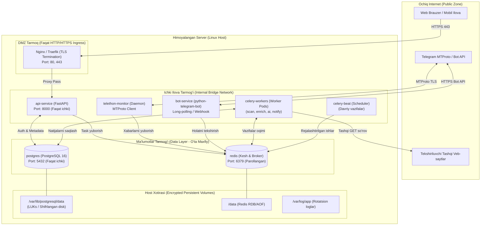

# 04. Joylashtirish Topologiyasi va Infratuzilma (Deployment Topology)

## 1. Kirish va Maqsad

Ushbu hujjat Telegram fishing va firibgarlikni aniqlash backend platformasining server darajasidagi joylashtirish (deployment) topologiyasi, konteynerlar iyerarxiyasi, tarmoq izolyatsiyasi va resurslarni boshqarish talablarini belgilaydi.

Tizim xavfsizligi faqat dasturiy kod darajasida emas, balki operatsion tizim, Docker tarmoqlari va server konfiguratsiyasi darajasida ham taʼminlanishi shart.

---

## 2. Joylashtirish Topologiyasi Diagrammasi

Quyidagi diagrammada konteynerlar va tarmoq zonalari tasvirlangan:

---

## 3. Konteynerlar va Xizmatlar Roʻyxati

Tizim Docker Compose (yoki Kubernetes) orqali boshqariluvchi quyidagi asosiy konteynerlardan tashkil topgan:

### 3.1 `reverse-proxy` (Nginx / Caddy)
* **Vazifasi:** Tashqi dunyodan faqat bitta kirish nuqtasi.
* **Xavfsizlik:**
  * TLS 1.3 shifrlashni majburiy qilish.
  * HSTS (HTTP Strict Transport Security), CSP (Content Security Policy) sarlavhalarini qoʻshish.
  * Tezkor soʻrovlar (DDoS / Brute-force) uchun Rate Limiting oʻrnatish.
  * Toʻgʻridan-toʻgʻri PostgreSQL yoki Redis portlarini tashqi dunyoga aslo ochmaslik.

### 3.2 `api-service` (FastAPI)
* **Vazifasi:** REST API serveri (Uvicorn / Gunicorn asosida).
* **Konfiguratsiya:** Faqat `DMZ_Network` va `App_Network` bilan bogʻlangan. Tashqi IP manzilga ega emas.

### 3.3 `telethon-monitor` (Telegram Userbot Monitor)
* **Vazifasi:** Telegram hisoblarining doimiy faol mijozlarini ushlab turish (Daemon jarayon).
* **Talablar:**
  * Toʻxtab qolishlardan soʻng avtomatik qayta yuklanish (`restart: unless-stopped`).
  * Shifrlangan sessiyalarni bazadan oʻqish va faqat xotirada (RAM) decrypt holatda saqlash.

### 3.4 `bot-service` (Telegram Bot)
* **Vazifasi:** Foydalanuvchilarga xabarnomalar va komandalar bilan ishlash interfeysi.

### 3.5 `celery-workers` (Fon Ishchilari)
* **Vazifasi:** Skanerlash, maʼlumot boyitish, Gemini AI va xabarnomalar.
* **Masshtablash:** Yuklama oshgan sari Celery workerlar sonini osongina koʻpaytirish (`docker compose up --scale celery-worker=4`) mumkin.

### 3.6 `celery-beat` (Davriy Vazifalar)
* **Vazifasi:** Har soatlik/kunlik tozalash ishlari (muddati oʻtgan keshlar, eski auditi oʻchirish, zaxira nusxalash).

### 3.7 `redis` (Kesh va Xabarlar Brokeri)
* **Xavfsizlik:**
  * Kuchli parol orqali himoyalangan (`requirepass`).
  * Faqat ichki `Data_Network` tarmogʻida mavjud, tashqaridan toʻgʻridan-toʻgʻri kirish mutlaqo yopiq.

### 3.8 `postgres` (PostgreSQL 16)
* **Xavfsizlik:**
  * Alohida shifrlangan hajmdagi (encrypted persistent volume) diskda saqlanadi.
  * Faqat ichki tarmoqdan ulanish mumkin.
  * Root boʻlmagan maxsus tizim foydalanuvchisi (`postgres`) ostida ishlaydi.

---

## 4. Tarmoq Xavfsizligi va Izolyatsiya Qoidalari

1. **Tashqi portlar minimalizmi:** Serverda faqat `80` (HTTP) va `443` (HTTPS) portlari ochiq boʻladi. Hech bir maʼlumotlar bazasi yoki kesh porti (5432, 6379, 8000) ommaviy internetga taqdim etilmaydi.
2. **Konteynerlararo chegaralar:** `Data_Network` tarmogʻiga faqat vakolatli konteynerlar (API, Workers) ulanadi. Nginx ushbu tarmoqqa kira olmaydi.
3. **Egress (Chiqish) nazorati:** Celery workerlari tashqi veb-saytlarni tekshirayotganda, server ichidagi mahalliy tarmoq IP-lariga (10.0.0.0/8, 192.168.0.0/16, 172.16.0.0/12, 127.0.0.1) soʻrov yuborishi dasturiy va tarmoq (iptables) darajasida cheklanadi.

---

## 5. Resurslarni Cheklash (Resource Limits)

Har bir konteyner uchun xotira (RAM) va protsessor (CPU) limitlari Docker darajasida qatʼiy oʻrnatiladi:
* Bu xavfli yoki zaharli veb-saytlar tahlil qilinayotganda xotira toʻlib ketishi (Memory Leak / Denial of Service) orqali butun serverni toʻxtatib qoʻyishining oldini oladi.
* Masalan: bitta skanerlash ishchisi uchun maksimal xotira hajmi 512MB-1GB oraligʻida chegaralanadi.
