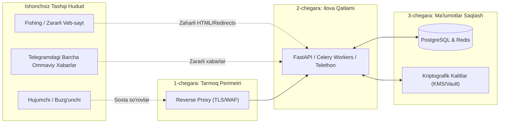

# 01. Tahdidlar Modeli (Threat Model)

## 1. Kirish va Maqsad

Telegram Fishing va Firibgarlikni Aniqlash Platformasi yuqori darajada xavfsizlikka sezgir tizimdir. Tizim foydalanuvchilarning Telegram sessiyalarini boshqaradi, tashqi ishonchsiz veb-saytlar bilan muloqot qiladi va sun'iy intellekt orqali xulosa chiqaradi.

Ushbu hujjat Microsoft tomonidan ishlab chiqilgan **STRIDE** modeli asosida loyihadagi asosiy tahdidlar, xavf vektorlari, hujum nuqtalari va ularni bartaraf etish (mitigation) choralarini belgilaydi.

---

## 2. Ishonch Chegaralari (Trust Boundaries)

Tizimda 4 ta asosiy ishonch chegarasi mavjud:
1. **Foydalanuvchi va API oʻrtasida:** API'ga keluvchi har bir soʻrov ishonchsiz hisoblanadi (JWT tekshiruvi shart).
2. **Ilova va Tashqi veb-saytlar oʻrtasida:** URL skaner hech qachon tashqi serverga toʻliq ishonmaydi (SSRF, cheksiz redirect va zip-bomb xavfi).
3. **Ilova va Telegram oʻrtasida:** Telegram xabarlaridagi har qanday matn va havola zararli deb qaraladi.
4. **Ilova va Maʼlumotlar bazasi oʻrtasida:** Maʼlumotlar bazasi zaxira nusxalari (backup) yoki dump fayllari oʻgʻirlangan taqdirda ham oʻta maxfiy maʼlumotlar (Telethon sessiyalari) oʻqilmasligi uchun ilova darajasida shifrlanadi.

---

## 3. STRIDE Boʻyicha Tahdidlar Tahlili

### 3.1 Spoofing (Shaxsiyatni Soxtalashtirish)
* **Tahdid:** Hujumchi boshqa foydalanuvchining Telegram hisobi nomidan soxta sessiya oʻrnatishi yoki Telegram bot xabarnomalarini soxtalashtirishi mumkin.
* **Qarshi choralar:**
  * Telethon hisobini ulashda Telegram tomonidan yuboriladigan OTP kod va 2FA parol faqat bir marta vaqtinchalik xotirada tekshiriladi.
  * Sessiya maʼlumotlari faqat tizimdagi aniq foydalanuvchi ID (`user_id`) bilan qatʼiy bogʻlanadi.
  * Bot xabarnomalari faqat rasmiy Bot Token orqali va aniq tasdiqlangan `chat_id` ga yuboriladi.

### 3.2 Tampering (Ma'lumotlarni Qasddan Oʻzgartirish)
* **Tahdid:** Hujumchi URL skanerlash natijalarini, xavf ballarini (Risk Score) yoki shifrlangan sessiya fayllarini oʻzgartirishi mumkin.
* **Qarshi choralar:**
  * Telethon sessiyalari **AES-256-GCM** (Authenticated Encryption) orqali saqlanadi. Shifrlangan maʼlumot hatto 1 bit oʻzgartirilsa ham, autentifikatsiya tegi (Auth Tag) tufayli shifrdan chiqarish xato beradi va rad etiladi.
  * Skan natijalari va dalillar zanjiri (evidence trail) bazada audit sifatida faqat qoʻshiluvchi (append-only) qilib yoziladi.

### 3.3 Repudiation (Inkor Qilish / Javobgarlikdan Boʻyin Tovlash)
* **Tahdid:** Foydalanuvchi akkauntini ulab, soʻng "Men bu tizimga ruxsat bermaganman" deb daʼvo qilishi mumkin.
* **Qarshi choralar:**
  * Har bir muhim harakat (hisob ulash, sessiyani uzish, skan sozlamalarini oʻzgartirish) foydalanuvchi ID-si, IP manzili va vaqt tamgʻasi (timestamp) bilan xavfsiz `audit_logs` jadvalida qayd etiladi.

### 3.4 Information Disclosure (Maxfiy Ma'lumotlarning Sizib Chiqishi)
* **Tahdid:** 
  1. Telethon sessiya stringlari yoki API kalitlarining log fayllarda ochiq yozilib qolishi.
  2. Bir foydalanuvchi boshqa foydalanuvchining skan natijalari yoki chatlarini koʻrib qolishi (IDOR / Cross-tenant access).
* **Qarshi choralar:**
  * Barcha logerlar (Logging filters) maxsus filtr bilan taʼminlanadi: session stringlar, telefon raqamlar, OTP kodlar va API kalitlar avtomatik `[REDACTED]` ga almashtiriladi.
  * Har bir soʻrovda `user_id` asosida qatʼiy avtorizatsiya va maʼlumotlar izolyatsiyasi tekshiriladi.
  * Baza dump qilinganda ham sessiyalar AES-256-GCM shifrlangan boʻladi.

### 3.5 Denial of Service (Xizmatdan Foydalanishni Toʻxtatib Qoʻyish - DoS)
* **Tahdid:**
  1. URL skaneriga qasddan ulkan hajmdagi (masalan, 10 GB) fayllarga yoki cheksiz redirect zanjiriga ega havolalarni yuborish orqali xotira va tarmoqni toʻldirish.
  2. Telegram FloodWait keltirib chiqarish.
* **Qarshi choralar:**
  * HTTP soʻrovlar maksimal 5 soniya timeout va maksimal 2 MB hajmdagi yuklash limiti bilan cheklanadi (`Bounded Fetch`).
  * Yoʻnaltirishlar (Redirects) soni koʻpi bilan 3-5 tagacha cheklanadi.
  * Telegram MTProto soʻrovlari token bucket algoritmi orqali limitlanadi.

### 3.6 Elevation of Privilege (Huquqlarni Noqonuniy Oshirish / SSRF)
* **Tahdid:** Hujumchi chatga `http://169.254.169.254/latest/meta-data/` (bulut metadata) yoki `http://127.0.0.1:5432` kabi havolalarni yuborib, tizim serverining ichki tarmogʻiga kirishga urinishi (Server-Side Request Forgery - SSRF).
* **Qarshi choralar:**
  * **Qat'iy SSRF Filteri:** Tashqi soʻrov yuborishdan oldin domen DNS orqali IP-ga yechiladi. Barcha lokal, loopback, private va link-local IP manzillarga soʻrov yuborish qatʼiyan bloklanadi.
  * Celery workerlari alohida izolyatsiyalangan Docker tarmogʻida ishlaydi.

---

## 4. Qoldiq Xavflar (Residual Risks)

Har qanday mukammal xavfsizlik tizimida ham ba'zi qoldiq xavflar mavjud boʻladi:
1. **Serverning toʻliq buzilishi (Host Compromise):** Agar xaker operatsion tizim darajasida root huquqiga ega boʻlsa, xotirada (RAM) turgan faol Telethon sessiyalarini oʻqib olishi mumkin. Buni kamaytirish uchun minimal root huquqisiz konteynerlar va muntazam xavfsizlik yangilanishlari (patch management) talab etiladi.
2. **0-Day Telegram Vulnerabilities:** Telegram MTProto protokoli yoki Telethon kutubxonasidagi hali nomaʼlum zaifliklar. Kutubxonalar faqat barqaror va tekshirilgan versiyalarda yangilab boriladi.
