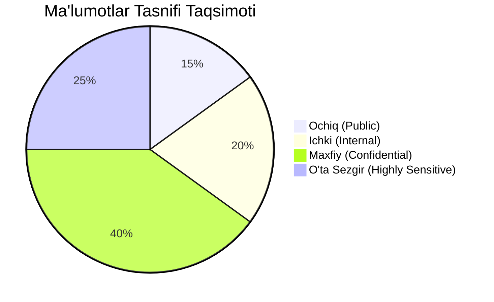

# 02. Ma'lumotlar Tasnifi va Maxfiylik (Data Classification)

## 1. Kirish va Maqsad

Loyiha doirasida saqlanadigan, qayta ishlanadigan va uzatiladigan barcha maʼlumotlar ularning noziklik darajasi (sensitivity) va xavfsizlik talablariga qarab aniq toifalarga (tasniflarga) ajratiladi.

Maʼlumotlar tasnifi maʼlumotlar bazasi jadvallarini loyihalash, shifrlash usullarini tanlash, loglash qoidalarini belgilash va saqlash muddatlarini (retention) oʻrnatishda asosiy qoʻllanma hisoblanadi.

---

## 2. Ma'lumotlar Tasnifi Darajalari (Classification Levels)

Tizimda 4 ta asosiy maʼlumot toifasi belgilangan:

### 2.1 Ochiq (Public)
* **Tavsif:** Oshkor qilinishi tizimga yoki foydalanuvchiga hech qanday zarar yetkazmaydigan maʼlumotlar.
* **Misollar:**
  * Ommaviy texnik hujjatlar (docs).
  * API xizmatining umumiy taʼrifi va ochiq endpointlar roʻyxati.
  * Ommaviy tahdid razvedkasi (threat feed) qora roʻyxatlari.
* **Himoya talabi:** Butunlik (Integrity) nazorati; maxsus shifrlash talab qilinmaydi.

### 2.2 Ichki (Internal)
* **Tavsif:** Faqat tizim xodimlari va ichki servislar uchun moʻljallangan, lekin foydalanuvchilarning shaxsiy maʼlumotlarini oʻz ichiga olmaydigan maʼlumotlar.
* **Misollar:**
  * Dastur konfiguratsiyasi parametrlari (maxfiy parollarsiz).
  * Tizimning umumiy ishlash metrikalari (Prometheus metrikalari: CPU, RAM, navbat uzunligi).
  * Celery vazifalarining umumiy identifikatorlari va holatlari.
* **Himoya talabi:** Tashqi dunyodan himoyalangan tarmoq, autentifikatsiyalangan kirish.

### 2.3 Maxfiy (Confidential)
* **Tavsif:** Foydalanuvchilarning shaxsiy maʼlumotlari, chatlari va skan natijalari. Agar oshkor boʻlsa, foydalanuvchi maxfiyligi buzilishi mumkin.
* **Misollar:**
  * Foydalanuvchilar profili (ID, username, email).
  * Telegram chat va guruh metamaʼlumotlari (nomi, aʼzolar soni, chat_id).
  * Skanerlangan havolalar tarixi va toʻplangan dalillar.
  * Foydalanuvchi kontaktlari (agar ruxsat berilgan boʻlsa).
  * Foydalanuvchi havolalariga aloqador ichki loglar.
* **Himoya talabi:** Maʼlumotlar bazasida qatʼiy RBAC (foydalanuvchi faqat oʻziga tegishlisini koʻrishi), TLS orqali uzatish, kirishni audit qilish.

### 2.4 Oʻta Sezgir (Highly Sensitive)
* **Tavsif:** Tizim yoki foydalanuvchi hisobiga bevosita kirish huquqini beruvchi, oshkor boʻlishi jiddiy kiberxavfsizlik fojiasiga olib kelishi mumkin boʻlgan maʼlumotlar.
* **Misollar:**
  * **Telethon sessiya ma'lumotlari** (Session strings va auth keys).
  * Hisob ulash paytidagi **Telegram SMS kodi (OTP)** va **2FA paroli**.
  * Ilovaning asosiy **shifrlash kalitlari (AES-256 Master Key)**.
  * Telegram Bot tokenlari va maʼlumotlar bazasi parollari.
  * Foydalanuvchining shaxsiy telefon raqamlari.
* **Himoya talabi:**
  * Maʼlumotlar bazasida **AES-256-GCM** ilova darajasida shifrlangan boʻlishi shart.
  * OTP va 2FA parollari hech qachon bazaga yozilmaydi (faqat vaqtinchalik xotirada tekshiriladi).
  * Log fayllarda koʻrinishi qatʼiyan man etiladi (`[REDACTED]`).

---

## 3. Ma'lumotlarni Minimallashtirish Qoidalari (Data Minimization)

Platforma GDPR va kiberxavfsizlikning "Data Minimization" tamoyiliga qatʼiy amal qiladi:

1. **Tarixiy xabarlarni yuklamaslik:** Telethon ulanishi bilan guruhlardagi yillar davomida toʻplangan xabarlar bazaga yuklab olinmaydi. Faqat ulanishdan keyin kelgan yangi xabarlar real vaqtda tahlil qilinadi.
2. **Xabar matnini toʻliq saqlamaslik:** Xabarning butun matni oʻrniga, faqat aniqlangan URL va havola atrofidagi bir nechta soʻz (kontekst) saqlanadi. Shaxsiy yozishmalar bazada toʻplanmaydi.
3. **HTML sahifalarini toʻliq saqlamaslik:** Skan qilingan saytlarning butun HTML kodi saqlanmaydi; faqat tahlil uchun zarur boʻlgan sarlavha (title), meta-teglar va qisqartirilgan matn (max 50-100 KB) dalil sifatida saqlanadi.
4. **URL parametrlarini tozalash:** Havola ichida boʻlishi mumkin boʻlgan auth-tokenlar, sessiya ID-lari va shaxsiy parametrlarni tozalab (strip), keyin bazaga yozish talab etiladi.
5. **Kontaktlarni faqat ixtiyoriy sinxronlash:** Kontaktlar roʻyxati majburiy emas; foydalanuvchi maxsus ruxsat bergandagina faqat kerakli minimal maydonlar olinadi.

---

## 4. Ma'lumotlar Tasnifi Matritsasi (Summary Matrix)

| Ma'lumot Turi | Tasnifi | Saqlash Joyi | Shifrlash Usuli | Loglanadimi? | Saqlash Muddati |
| :--- | :--- | :--- | :--- | :--- | :--- |
| **Telethon Session** | Oʻta Sezgir | PostgreSQL (`telegram_accounts`) | AES-256-GCM (Ilova darajasida) | QATʼIYAN YOʻQ | Akkaunt uzilguncha |
| **Telegram OTP / 2FA** | Oʻta Sezgir | Faqat RAM (Xotira) | Saqlanmaydi | QATʼIYAN YOʻQ | 5 daqiqa (ulanish payti) |
| **Master Key** | Oʻta Sezgir | KMS / Environment | OS / Vault darajasida | QATʼIYAN YOʻQ | Doimiy |
| **Telefon Raqam** | Oʻta Sezgir | PostgreSQL (`users`) | Shifrlangan / Hashlangan | QATʼIYAN YOʻQ | Foydalanuvchi oʻchirilguncha |
| **Skanerlangan URL** | Maxfiy | PostgreSQL (`scanned_urls`) | TLS tranzitda | Faqat Hash/Kanonik URL | 90 kun |
| **Gemini / AI Xulosasi** | Maxfiy | PostgreSQL (`threat_assessments`) | Standart DB | Ha (Info darajasida) | 90 kun |
| **Xatolik Loglari** | Ichki | Disk / Graylog | TLS tranzitda | Ha (Redacted holda) | 30 kun |
