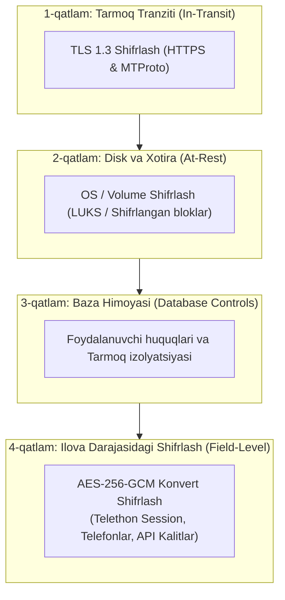

# 03. Shifrlash va Kalitlarni Boshqarish (Encryption & Key Management)

## 1. Kirish va Maqsad

Loyiha foydalanuvchilarning Telegram sessiyalarini va shaxsiy maʼlumotlarini boshqargani sababli, maʼlumotlar bazasining disk darajasidagi shifrlanishi (Volume encryption) yoki oddiy baza paroli yetarli hisoblanmaydi. Agar tajovuzkor maʼlumotlar bazasi zaxira nusxasini (SQL dump) oʻgʻirlasa ham, Telethon sessiyalarini oʻqiy olmasligi shart.

Ushbu hujjat **Ilova darajasidagi autentifikatsiyalangan shifrlash (Application-Level Authenticated Encryption)** standartini belgilaydi.

---

## 2. Koʻp Qatlamli Shifrlash Modeli (Defense in Depth)



---

## 3. Ilova Darajasidagi Shifrlash Standarti: AES-256-GCM

Sessiyalar va oʻta sezgir maydonlarni shifrlash uchun **AES-256-GCM** (Galois/Counter Mode) algoritmi tanlangan.

### Nima uchun aynan AES-256-GCM?
1. **AEAD (Authenticated Encryption with Associated Data):** Maʼlumot nafaqat maxfiy saqlanadi, balki uning butunligi (Integrity) va haqiqiyligi (Authenticity) kafolatlanadi.
2. **Qasddan oʻzgartirishdan himoya:** Agar shifromatndan 1 bayt oʻzgartirilsa ham, autentifikatsiya tegi (Auth Tag) mos kelmaydi va xatolik beradi (`InvalidTag`).
3. **Yuqori tezlik:** Zamonaviy protsessorlarda AES-NI apparat instruksiyalari mavjudligi tufayli juda tez ishlaydi.

---

## 4. Shifrlangan Ma'lumot Konvert Formati (Envelope Format)

Har bir shifrlangan maydon bazada binar yoki base64 koʻrinishida maxsus standart konvert formatida saqlanadi:

```text
+---------+----------------+---------------+--------------------+------------------+
| Version | Key Identifier | Nonce / IV    | Ciphertext         | Auth Tag         |
| (1 bayt)| (4 bayt int)   | (12 bayt)     | (N bayt o'zgaruv.) | (16 bayt)        |
+---------+----------------+---------------+--------------------+------------------+
```

### Konvert komponentlari:
1. **Format Version (`1 bayt`):** Konvert formati versiyasi (masalan, `0x01`). Kelajakda yangi shifrlash algoritmlariga oʻtishda orqaga moslikni taʼminlaydi.
2. **Key ID (`4 bayt`):** Ushbu yozuv qaysi kalit bilan shifrlanganini bildiradi. Kalitlarni almashtirishda (Key Rotation) qaysi eski kalit bilan ochishni bilish uchun xizmat qiladi.
3. **Nonce / Initialization Vector (`12 bayt`):** Har bir shifrlash uchun takrorlanmas, kriptografik xavfsiz tasodifiy son (`os.urandom(12)`). **Hech qachon bitta kalit bilan bir xil Nonce ishlatilmaydi!**
4. **Ciphertext (`N bayt`):** Haqiqiy maʼlumotning shifrlangan koʻrinishi.
5. **Auth Tag (`16 bayt`):** GCM tegi. Butunlikni tekshirish uchun.

### Bogʻlangan Ma'lumotlar (Associated Authenticated Data - AAD)
Nusxalab koʻchirish hujumlarini (Copy-Paste attack) oldini olish uchun shifrlashda **AAD** sifatida yozuvning egasi ID-si ishlatiladi:
* Masalan: `account_id` yoki `user_id`.
* Agar tajovuzkor bir foydalanuvchining shifrlangan sessiyasini olib, boshqa foydalanuvchining qatoriga joylab qoʻysa, AAD mos kelmagani uchun shifr ochilmaydi!

---

## 5. Kalitlarni Boshqarish va Aylantirish (Key Rotation)

1. **Kalitlarni saqlash:**
   * Boshlangʻich bosqichda: Operatsion tizimning maxfiy muhit oʻzgaruvchisi (`APP_MASTER_KEY`).
   * Ishlab chiqarish (Production) bosqichida: HashiCorp Vault yoki AWS KMS / GCP Secret Manager.
   * Shifrlash kalitlari hech qachon Git repozitoriyasiga, kodga yoki oddiy matnli fayllarga yozilmaydi.
2. **Kalitlarni aylantirish (Key Rotation) jarayoni:**
   * Tizim konfiguratsiyasida bir nechta kalitlar roʻyxati saqlanadi: `KEYS = {1: key_v1, 2: key_v2}`.
   * Doim eng soʻnggi kalit `ACTIVE_KEY_ID = 2` boʻladi.
   * Yangi maʼlumotlar faqat faol kalit bilan shifrlanadi.
   * Eski maʼlumotlar oʻqilayotganda konvertdagi `Key ID` ga qarab tegishli kalit tanlanadi va shifr ochiladi.
   * Alohida fon vazifasi (migration script) orqali eski kalitdagi maʼlumotlarni yangi faol kalitga qayta shifrlash (re-encryption) amalga oshiriladi.

---

## 6. Foydalanuvchi Parollari (Argon2id)

* Agar tizimda mahalliy foydalanuvchi hisoblari boʻlsa, parollar hech qachon qaytariluvchi (reversible) shifrlanmaydi.
* Parollar uchun zamonaviy xalqaro xavfsizlik standarti — **Argon2id** (memory-hard password hashing) ishlatiladi.
* **Telegram 2FA parollari va OTP kodlar hech qachon bazada saqlanmaydi!** Ular faqatgina login jarayonida Telethon mijozi orqali Telegram serverlariga uzatiladi va xotiradan tozalanadi.
