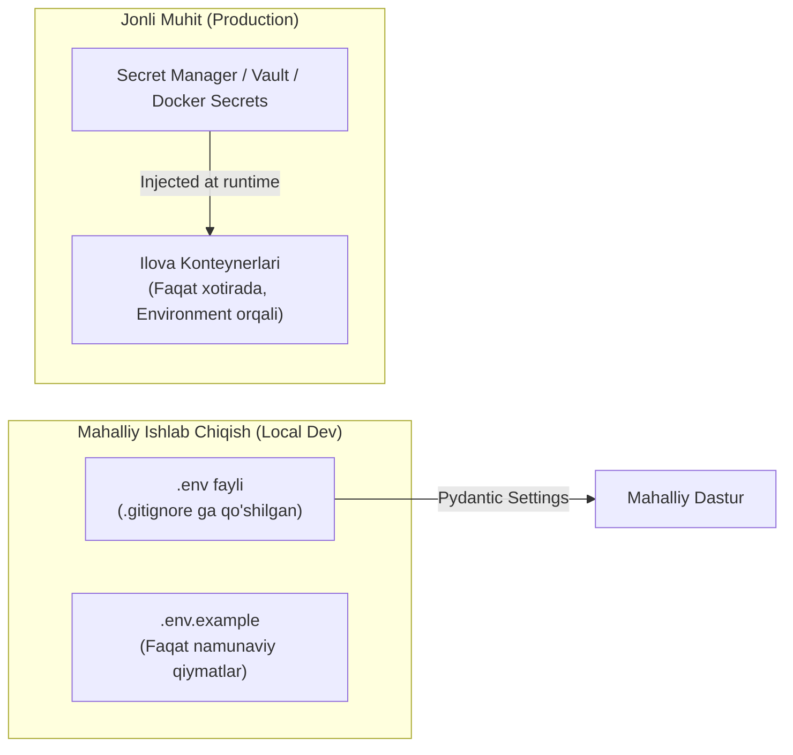

# 04. Maxfiy Ma'lumotlarni Boshqarish (Secrets Management)

## 1. Kirish va Maqsad

Ushbu hujjat tizimda qoʻllaniladigan barcha maxfiy kalitlar, API tokenlari, maʼlumotlar bazasi parollari va Telegram hisob maʼlumotlarining xavfsiz hayotiy siklini (yaratish, saqlash, uzatish, aylantirish va bekor qilish) belgilaydi.

Maxfiy maʼlumotlarning biror marta ham ochiq repozitoriyga, log fayllarga yoki xatolik hisobotlariga (stack traces) tushib qolishi mutlaqo yoʻl qoʻyib boʻlmaydigan xavfsizlik buzilishi (security breach) hisoblanadi.

---

## 2. Loyihadagi Maxfiy Ma'lumotlar Roʻyxati

| Maxfiy Ma'lumot Nomi | Oʻzgaruvchi Nomi | Vazifasi va Joylashuvi |
| :--- | :--- | :--- |
| **Telegram API ID & Hash** | `TELEGRAM_API_ID`, `TELEGRAM_API_HASH` | Telegram MTProto mijozini roʻyxatdan oʻtkazish |
| **Telegram Bot Token** | `TELEGRAM_BOT_TOKEN` | Foydalanuvchilarga xabarnomalar yuboruvchi bot kaliti |
| **Ilova Shifrlash Kaliti** | `APP_MASTER_KEY` | AES-256-GCM uchun 32-baytlik asosiy kriptografik kalit |
| **JWT Secret Key** | `JWT_SECRET_KEY` | Foydalanuvchi sessiya tokenlarini imzolash uchun kalit |
| **PostgreSQL Paroli** | `POSTGRES_PASSWORD`, `DATABASE_URL` | Maʼlumotlar bazasiga xavfsiz ulanish |
| **Redis Paroli** | `REDIS_PASSWORD`, `REDIS_URL` | Redis brokeri va keshiga parollangan ulanish |
| **Google Gemini API Key** | `GEMINI_API_KEY` | Sun'iy intellekt tahlil xizmatidan foydalanish kaliti |

---

## 3. Muhitlar Boʻyicha Saqlash Qoidalari

### 3.1 Mahalliy Ishlab Chiqish (Local Development)
* Barcha sozlamalar `.env` faylida saqlanadi.
* **`.env` fayli hech qachon Git repozitoriyasiga qoʻshilmaydi (`.gitignore` qatʼiy nazorat qiladi).**
* Yangi dasturchilar uchun faqat `.env.example` shablon fayli taqdim etiladi. Ushbu faylda hech qanday haqiqiy parollar yoki ishchi API kalitlar boʻlishi mumkin emas.

### 3.2 Ishlab Chiqish va Jonli Muhit (Production)
* Jonli serverlarda `.env` faylini ochiq holda saqlash tavsiya etilmaydi.
* Konteynerlarga maxfiy kalitlar xavfsiz usulda: Docker Secrets, Kubernetes Secrets yoki tashqi KMS (HashiCorp Vault, AWS Secrets Manager) orqali konteyner ishga tushirilganda xotiraga (RAM) uzatiladi.

---

## 4. Sizib Chiqishdan Himoya Mexanizmlari (Anti-Leakage Safeguards)

1. **Git Commits Tekshiruvi (Pre-commit Hooks):**
   * Kodni Git-ga yuklashdan oldin `gitleaks` yoki `detect-secrets` utilitasi orqali har bir qator tekshiriladi. Agar kodda tasodifan API kalit yoki parol aniqlansa, commit qatʼiyan bloklanadi.
2. **Loglarni Tozalash (Log Redaction):**
   * Dasturning barcha logerlariga maxsus xavfsizlik filtri ulanadi.
   * `session_string`, `password`, `token`, `api_key`, `otp` soʻzlarini oʻz ichiga olgan har qanday maʼlumot logga yozilishidan oldin `[REDACTED]` ga almashtiriladi.
3. **Xatoliklar va Stack Trace Xavfsizligi:**
   * Ishlab chiqarish rejimida FastAPI'ning batafsil xatolik sahifalari (`debug=False`) oʻchiriladi.
   * Tashqi foydalanuvchiga faqat umumiy xatolik kodi (masalan, `{"error": "INTERNAL_SERVER_ERROR", "request_id": "xyz"}`) koʻrsatiladi, ichki parametrlar va kalitlar yashiriladi.

---

## 5. Kalitlar Bekor Qilinganda Munosabat (Key Revocation)

Agar biron bir API kalit yoki Telegram Bot Tokeni oshkor boʻlib qolsa (compromised):
1. Telegram Bot Father yoki Google Cloud Console orqali zudlik bilan eski token bekor qilinadi (revoke) va yangisi generatsiya qilinadi.
2. Tizim konfiguratsiyasiga yangi kalit kiritilib, xizmatlar qayta yuklanadi (`zero-downtime rolling restart`).
3. Hodisa xavfsizlik jurnaliga (Incident Report) kiritiladi.
