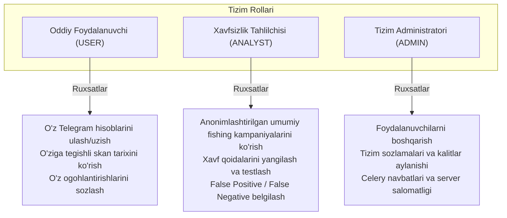

# 05. Kirish Huquqlari va Avtorizatsiya (Access Control & RBAC)

## 1. Kirish va Maqsad

Ushbu hujjat tizimda foydalanuvchilar, operatorlar va maʼmurlar uchun ruxsatlarni boshqarish (Role-Based Access Control - RBAC), minimal huquqlar tamoyili (Principle of Least Privilege) hamda foydalanuvchilar oʻrtasidagi maʼlumotlar izolyatsiyasini (Cross-Tenant Isolation) taʼminlash qoidalarini belgilaydi.

---

## 2. Foydalanuvchi Rollari va Imkoniyatlari

Tizimda 3 ta asosiy foydalanuvchi roli mavjud:



### Ruxsatlar Matritsasi:

| Amal / Resurs | USER | ANALYST | ADMIN |
| :--- | :---: | :---: | :---: |
| Oʻz Telegram hisobini ulash / uzish | ✅ | ✅ | ✅ |
| Oʻzining skanerlangan havolalari va hisobotlari | ✅ | ✅ | ✅ |
| Boshqa foydalanuvchilarning havolalari va chatlarini koʻrish | ❌ | ❌ (Faqat anonim) | ❌ (Maxfiylik himoyalangan) |
| Umumiy fishing statistikasi va tahdid hisobotlari | ❌ | ✅ | ✅ |
| Tizim konfiguratsiyasi va kalitlarni aylantirish | ❌ | ❌ | ✅ |
| Foydalanuvchilarni bloklash / oʻchirish | ❌ | ❌ | ✅ |
| Audit jurnallarini (Audit Logs) koʻrish | ❌ | ❌ | ✅ |

---

## 3. Foydalanuvchilararo Ma'lumotlar Izolyatsiyasi (Anti-IDOR)

Eng koʻp uchraydigan zaifliklardan biri bu **IDOR (Insecure Direct Object Reference)** boʻlib, bunda foydalanuvchi URL yoki API soʻrovidagi ID raqamini oʻzgartirib (masalan, `/api/v1/scans/123` oʻrniga `/api/v1/scans/124`), boshqa shaxsning shaxsiy maʼlumotlarini oʻqib olishi mumkin.

### Majburiy Muhandislik Qoidasi:
* Har bir maʼlumotlar bazasi soʻrovida obyekt egasi tekshirilishi shart:
  ```python
  # XATO VA XAVFLI USUL (IDOR zaifligi):
  query = select(ScannedUrl).where(ScannedUrl.id == scan_id)

  # TO'G'RI VA XAVFSIZ USUL:
  query = select(ScannedUrl).where(
      ScannedUrl.id == scan_id,
      ScannedUrl.user_id == current_user.id
  )
  ```
* Boshqa foydalanuvchiga tegishli resurs soʻralganda tizim `403 Forbidden` emas, balki obyekt mavjudligini ham oshkor qilmaslik uchun `404 Not Found` qaytaradi.

---

## 4. Autentifikatsiya va Sessiyalarni Bekor Qilish (Session Revocation)

1. **JWT Tokenlar:**
   * Foydalanuvchilar API bilan muloqotda qisqa muddatli `Access Token` (amal qilish muddati: 15-30 daqiqa) va xavfsiz `Refresh Token` (7 kun) dan foydalanadi.
2. **Akkauntdan chiqish (Logout):**
   * Foydalanuvchi tizimdan chiqqanida (Logout) uning tokeni Redis qora roʻyxatiga (Token Blacklist) kiritiladi va muddati tugaguncha qabul qilinmaydi.
3. **Telegram hisobini uzish:**
   * Foydalanuvchi oʻz Telegram hisobini oʻchirganda:
     1. Telethon mijoziga Telegram serverida sessiyani bekor qilish (`client.log_out()`) soʻrovi yuboriladi.
     2. Maʼlumotlar bazasidagi shifrlangan sessiya yozuvi toʻliq oʻchiriladi.
     3. Telethon fon monitoring jarayoni xotirasidan ushbu mijoz toʻxtatiladi.
