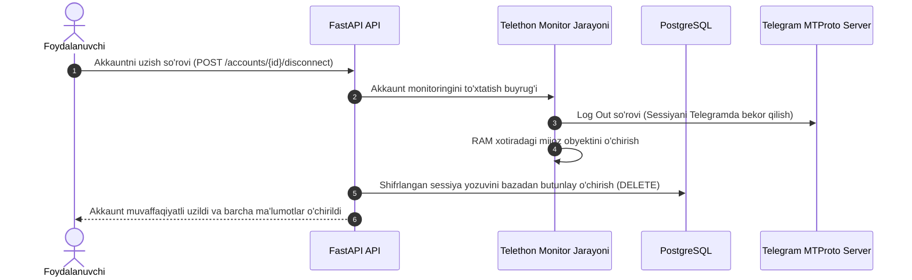

# 07. Maxfiylik va Ma'lumotlarni Saqlash Siyosati (Privacy & Retention)

## 1. Kirish va Maqsad

Telegram Fishing va Firibgarlikni Aniqlash Platformasi foydalanuvchilarning shaxsiy Telegram yozishmalari oqimiga yaqin joylashgan. Shu sababli, foydalanuvchilarning shaxsiy daxlsizligi (Privacy) va xalqaro maʼlumotlarni himoya qilish standartlari (GDPR tamoyillari) eng ustuvor vazifalardan biridir.

Ushbu hujjat foydalanuvchilarning qanday huquqlari borligi, maʼlumotlar qancha muddat saqlanishi (Retention Policy) va hisob oʻchirilganda tozalash mexanizmlarini belgilaydi.

---

## 2. Foydalanuvchining Maxfiylik Huquqlari

1. **Kirish Huquqi (Right to Access):** Foydalanuvchi tizimda oʻzi haqida qanday maʼlumotlar (ulangan hisoblar, skan qilingan havolalar) borligini koʻrish imkoniyatiga ega.
2. **Rozilikni Bekor Qilish (Revocation of Consent):** Foydalanuvchi istalgan vaqtda monitoringni toʻxtatishi va ulangan Telegram hisobini tizimdan uzishi mumkin.
3. **Toʻliq Oʻchirish Huquqi (Right to Erasure / Unutirilish huquqi):** Foydalanuvchi akkaunti oʻchirilganda, unga tegishli barcha maʼlumotlar maʼlumotlar bazasidan qaytarib boʻlmaydigan qilib (hard delete yoki toʻliq kaskadli tozalash) oʻchiriladi.

---

## 3. Ma'lumotlarni Saqlash Muddatlari (Retention Schedule)

Tizimda maʼlumotlar cheksiz saqlanmaydi. Har bir maʼlumot toifasi uchun qatʼiy saqlash muddati belgilangan:

| Ma'lumot Toifasi | Saqlash Muddati | Tozalash Mexanizmi |
| :--- | :---: | :--- |
| **Telethon Sessiyalari** | Faol ulanish davrida | Akkaunt uzilganda **darhol (0 soniya)** oʻchiriladi |
| **Xabar Metamatnlari (URL konteksti)** | **30 kun** | Celery Beat davriy tozalash vazifasi orqali |
| **Skanerlangan URL-lar va AI Dalillari** | **90 kun** | Qayta skanni oldini olish va tahlil uchun 90 kundan soʻng oʻchiriladi |
| **Yuborilgan Ogohlantirishlar Tarixi** | **60 kun** | Xabarnomalar audit jurnali 60 kundan keyin tozalanadi |
| **Xavfsizlik Audit Jurnallari (Audit Logs)**| **180 kun** | Kiberxavfsizlik tahlillari va qonuniy talablar uchun |
| **Kesh Ma'lumotlari (Redis)** | **24 soat** | Redis TTL (Time To Live) avtomatik oʻchirish |

---

## 4. Avtomatlashtirilgan Tozalash Jarayoni (Automated Pruning)

* Maʼlumotlar bazasini eski yozuvlardan tozalash har kecha (masalan, soat 03:00 da) `celery-beat` tomonidan ishga tushiriladigan maxsus fon vazifasi orqali amalga oshiriladi.
* **Batch Deletion (Boʻlib-boʻlib oʻchirish):** Bazani bloklab (lock) qoʻymaslik uchun yozuvlar birdaniga emas, balki 1000-5000 tadan qismlarga boʻlinib oʻchiriladi:
  ```sql
  DELETE FROM scanned_urls 
  WHERE created_at < NOW() - INTERVAL '90 days'
  LIMIT 5000;
  ```

---

## 5. Akkaunt Uzilganda Sessiyalarni Tozalash Algoritmi

Foydalanuvchi Telegram akkauntini uzganida (Disconnect Account):



Bu jarayon Telegram sessiyasining server xotirasida ham, maʼlumotlar bazasida ham asossiz saqlanib qolmasligini toʻliq kafolatlaydi.
