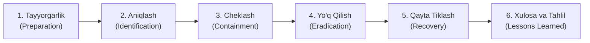

# 08. Xavfsizlik Hodisalariga Munosabat Bildirish (Incident Response Plan)

## 1. Kirish va Maqsad

Kiberxavfsizlikda eng muhim qoidalardan biri: *"Buziladimi yoki yo'qmi emas, balki QACHON buziladi va bunga qanchalik tayyormiz"* degan tamoyildir.

Ushbu hujjat kiberxavfsizlik hodisalari (sessiya oʻgʻirlanishi, kalitlarning oshkor boʻlishi, maʼlumotlar bazasi sizib chiqishi, SSRF xurujlari) yuz berganda jamoaning qanday harakat qilishi lozim boʻlgan aniq amaliy koʻrsatmalarni (Playbooks) oʻz ichiga oladi.

---

## 2. Hodisaga Munosabat Sikli (NIST SP 800-61 Standarti)

---

## 3. Asosiy Favqulodda Ssenariylar va Harakatlar Rejasi (Playbooks)

### 3.1 Ssenariy: Asosiy Shifrlash Kaliti (`APP_MASTER_KEY`) Oshkor Boʻldi
* **Xavf darajasi:** 🔴 CRITICAL (Favqulodda yuqori).
* **Harakatlar:**
  1. **Zudlik bilan cheklash:** Yangi AES-256 shifrlash kalitini yaratish (`ACTIVE_KEY_ID = N + 1`).
  2. **Qayta shifrlash:** Maxsus shifrlash skriptini (`scripts/rotate_keys.py`) ishga tushirib, bazadagi barcha mavjud sessiyalarni yangi kalit bilan qayta shifrlash.
  3. **Eski kalitni yoʻq qilish:** Tizim konfiguratsiyasidan oshkor boʻlgan eski kalitni butunlay olib tashlash.
  4. **Tekshirish:** Serverga kirish loglarini (SSH, Docker, API) tekshirib, kalit qanday sizib chiqqanini aniqlash.

### 3.2 Ssenariy: Telegram Sessiyasi Oʻgʻirlanganiga Shubha
* **Xavf darajasi:** 🔴 CRITICAL.
* **Harakatlar:**
  1. **Sessiyani bekor qilish:** Telethon orqali yoki Telegram API orqali ushbu sessiyani zudlik bilan `terminate_session` qilish.
  2. **Monitoringni toʻxtatish:** Telethon monitor xotirasidan ushbu mijozni oʻchirish.
  3. **Foydalanuvchini ogohlantirish:** Foydalanuvchiga Telegram xavfsizlik boʻlimidan "Barcha boshqa qurilmalarni uzish" (Terminate all other sessions) va 2FA parolini yangilash boʻyicha shoshilinch xabar yuborish.

### 3.3 Ssenariy: Ma'lumotlar Bazasi Zaxirasi (Backup) Oʻgʻirlandi
* **Xavf darajasi:** 🟠 HIGH.
* **Harakatlar:**
  1. Tinchlaning: Maʼlumotlar tasnifiga koʻra, barcha Telegram sessiyalari bazada **AES-256-GCM** bilan shifrlangan. Master kalitsiz ularni ochib boʻlmaydi.
  2. Bazaga ulanish parolini (`POSTGRES_PASSWORD`) darhol almashtirish va konteynerlarni qayta ishga tushirish.
  3. Zaxira nusxa saqlangan server yoki S3 bucket kirish huquqlarini tekshirish va yopish.

### 3.4 Ssenariy: Google Gemini API Kaliti Sizib Chiqdi yoki Kvota Tugadi
* **Xavf darajasi:** 🟡 MEDIUM.
* **Harakatlar:**
  1. Google Cloud Console orqali oshkor boʻlgan API kalitini oʻchirish (Delete) va yangi kalit generatsiya qilish.
  2. Tizim avtomatik ravishda Heuristic (Qoidalarga asoslangan) rejimda ishlashni davom ettiradi.
  3. Yangi API kalit muhitga kiritilgach, Celery navbatidagi kechiktirilgan AI tahlil vazifalari qayta ishga tushadi.

---

## 4. Xavfsizlik Hodisasini Hujjatlashtirish (Post-Mortem Hisobot)

Har qanday bartaraf etilgan jiddiy hodisadan keyin 48 soat ichida quyidagi bandlardan iborat xulosa hujjati tuziladi:
1. Hodisa tavsifi va xronologiyasi (qachon boshlandi, qachon aniqlandi, qachon yopildi).
2. Qaysi maʼlumotlar taʼsir ostida qoldi (Impact analysis).
3. Hujumning asosiy sababi (Root Cause).
4. Kelgusida bunday hodisani qaytarilmasligi uchun qilingan dasturiy va tashkiliy oʻzgarishlar.
