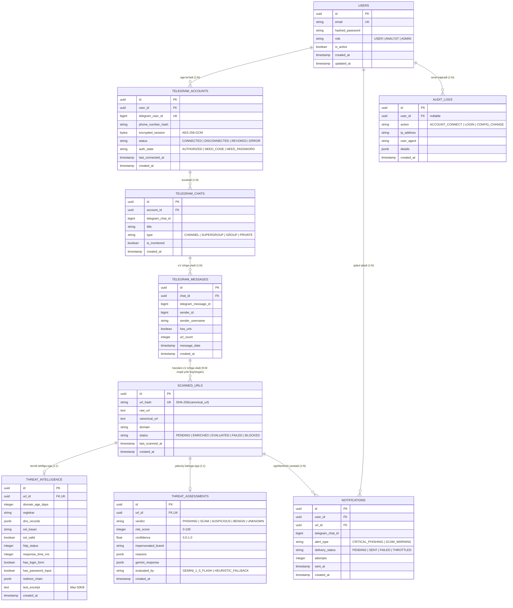

# 01. Ma'lumotlar Bazasi Modeli (Entity-Relationship Diagram — ERD)

## 1. Kirish va Maqsad

Ushbu hujjat PostgreSQL maʼlumotlar bazasining relyatsion modelini, jadvallar oʻrtasidagi munosabatlarni, birlamchi va tashqi kalitlarni (Primary / Foreign Keys) hamda kardinallik (1:1, 1:N, N:M) qoidalarini belgilaydi.

Sxema maʼlumotlar minimallashtirish, kaskadli tozalash (ON DELETE CASCADE) va tezkor qidiruv indekslarini hisobga olgan holda loyihalashtirilgan.

---

## 2. Toʻliq ERD Diagrammasi (Mermaid)

---

## 3. Aloqalar va Bogʻliqlik Qoidalari (Constraints & Foreign Keys)

1. **`users` -> `telegram_accounts`:**
   * Bir foydalanuvchi bir nechta Telegram hisoblarini ulashi mumkin (`1:N`).
   * Foydalanuvchi oʻchirilganda: `ON DELETE CASCADE` (Barcha unga tegishli hisoblar oʻchiriladi).
2. **`telegram_accounts` -> `telegram_chats`:**
   * Bitta hisob koʻplab guruh va kanallarni kuzatishi mumkin (`1:N`).
   * Hisob oʻchirilganda: `ON DELETE CASCADE`.
3. **`scanned_urls` -> `threat_intelligence` & `threat_assessments`:**
   * Bitta URL bitta texnik tahlil va bitta yakuniy bahoga ega boʻladi (`1:1`).
   * Bu havolalarni qayta-qayta tekshirish oʻrniga tezkor indekslangan `url_hash` orqali kesh natijasini darhol topish imkonini beradi.
4. **`scanned_urls` -> `notifications`:**
   * Agar bitta xavfli havola bir nechta guruhda tarqalsa, u boʻyicha turli foydalanuvchilarga alohida ogohlantirishlar yoziladi (`1:N`).

---

## 4. Qidiruv Indekslari (Indexes Strategy)

Yuqori unumdorlik va tezkor tahlil uchun quyidagi muhim indekslar yaratiladi:
* `scanned_urls(url_hash)` — **UNIQUE B-Tree Index**. Har bir kelgan havolani mikrosoniyalarda topish uchun.
* `scanned_urls(domain)` — Domen boʻyicha filtrlash.
* `threat_assessments(verdict, risk_score)` — Xavfli fishing tahlillarini hisobotlarda tezkor guruhlash uchun.
* `telegram_accounts(user_id, status)` — Foydalanuvchining faol akkauntlarini tez yuklash uchun.
* `notifications(user_id, delivery_status)` — Yetkazilmagan xabarlarni filtrlash uchun.
