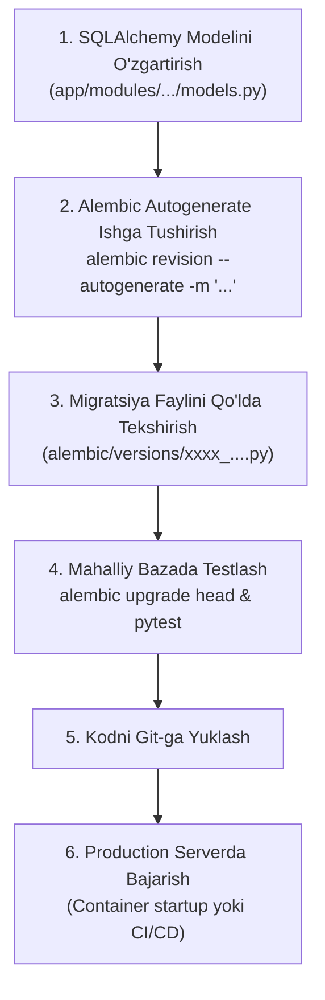

# 03. Ma'lumotlar Bazasi Migratsiyalari (Alembic Migrations)

## 1. Kirish va Maqsad

Loyiha maʼlumotlar bazasi sxemasini evolyutsion tarzda boshqarish uchun **Alembic** va **SQLAlchemy 2.x** kutubxonalaridan foydalaniladi. Maʼlumotlar bazasi sxemasiga har qanday oʻzgartirish faqat qatʼiy nazorat ostidagi migratsiya fayllari orqali amalga oshirilishi shart.

Ushbu hujjat yangi migratsiyalarni yaratish, tekshirish, qoʻllash va ishlab chiqarish (Production) muhitida toʻxtovsiz (Zero-Downtime) yangilash tartibini belgilaydi.

---

## 2. Migratsiya Hayotiy Sikli va Ish Sxemasi



---

## 3. Asosiy Alembic Buyruqlari

### 3.1 Yangi Migratsiya Yaratish
Modellarga oʻzgarish kiritilgandan soʻng:
```bash
alembic revision --autogenerate -m "create_scanned_urls_and_threat_tables"
```

### 3.2 Migratsiyalarni Qoʻllash (Upgrade)
Eng soʻnggi versiyaga oʻtish:
```bash
alembic upgrade head
```

### 3.3 Migratsiyani Orqaga Qaytarish (Rollback / Downgrade)
Bitta qadam orqaga qaytish:
```bash
alembic downgrade -1
```

### 3.4 Hozirgi Holatni Tekshirish
```bash
alembic current
alembic history --verbose
```

---

## 4. Qat'iy Muhandislik Qoidalari (Engineering Rules)

1. **Autogenerate fayllarini koʻr-koʻrona commit qilmang:**
   * Alembic baʼzi oʻzgarishlarni (masalan, PostgreSQL maxsus `ENUM` turlari, murakkab indekslar yoki jadvallarni qayta nomlash) toʻliq payqamasligi yoki xato talqin qilishi mumkin.
   * Har bir yaratilgan `alembic/versions/*.py` fayli dasturchi tomonidan satrma-satr tekshirilishi (`upgrade()` va `downgrade()` funksiyalari toʻgʻriligi) shart.
2. **`downgrade()` funksiyasini boʻsh qoldirmang:**
   * Har bir migratsiya orqaga qaytarilishi (reversible) mumkin boʻlishi lozim.
3. **Sxema va Ma'lumotlarni Alohida Qilish:**
   * Jadval strukturasini oʻzgartiruvchi DDL migratsiyalari va mavjud maʼlumotlarni yangilovchi (Data migrations) DML skriptlarini bitta faylga aralashtirmang.

---

## 5. Jonli Muhitda Toʻxtovsiz Yangilash (Zero-Downtime Deployment)

Ishlayotgan tizimda bazani yangilash paytida soʻrovlar toʻxtab qolmasligi uchun quyidagi qoidalarga rioya etiladi:

* **Ustun oʻchirish qoidasi:** Hech qachon ishlab turgan ustunni birdaniga oʻchirmang (`DROP COLUMN`). Avval dastur kodidan ushbu ustunni ishlatish olib tashlanadi (1-chi reliz), keyingi relizda esa ustun bazadan oʻchiriladi.
* **Yangi ustunlar qoʻshish:** Yangi qoʻshiladigan ustunlar yo `nullable=True` boʻlishi, yoki standart qiymatga (`server_default=...`) ega boʻlishi shart. Aks holda ulkan jadvallarda jadval bloklanishi (Table Lock) yuzaga keladi.
* **Konteynerlar tartibi:** Yangi versiyadagi dastur konteynerlari ishga tushishidan oldin alohida qisqa muddatli `migration-job` orqali `alembic upgrade head` muvaffaqiyatli oʻtishi tekshiriladi.
