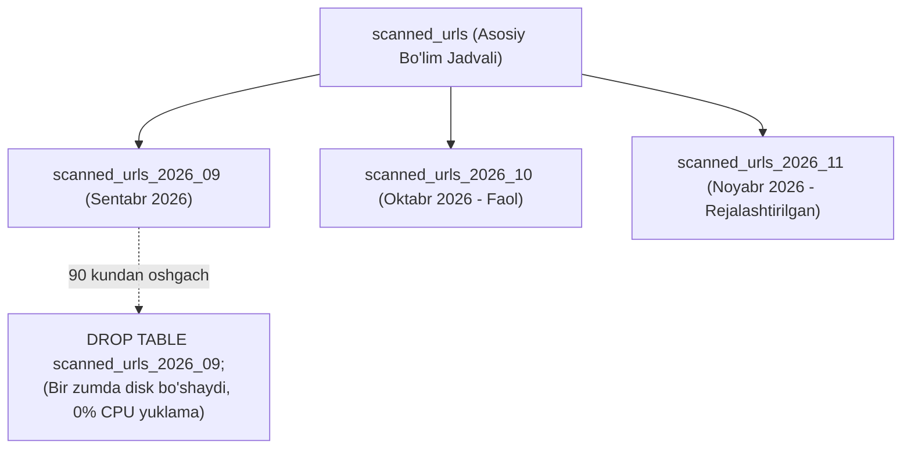

# 04. Bazada Saqlash va Tozalash Mexanizmi (Database Retention Implementation)

## 1. Kirish va Maqsad

Loyiha minglab guruhlar va yuz minglab xabarlardan kelib tushadigan havolalarni qayta ishlaydi. Agar eski maʼlumotlar oʻz vaqtida tozalanmasa:
1. Maʼlumotlar bazasi diski toʻlib qoladi.
2. Indekslar kattalashib, qidiruv tezligi (Query latency) pasayadi.
3. PostgreSQL'da `VACUUM` va boʻsh joylar (bloat) muammosi yuzaga keladi.
4. GDPR va maxfiylik siyosati buziladi.

Ushbu hujjat PostgreSQL darajasida maʼlumotlarni tozalash, qismlarga ajratish (Partitioning) va avtomatik tozalash (Autovacuum) arxitekturasini belgilaydi.

---

## 2. Jadvallarni Qismlarga Ajratish (Table Partitioning Strategy)

Vaqt boʻyicha tez oʻsuvchi jadvallar (`scanned_urls`, `notifications`, `audit_logs`) uchun **PostgreSQL Declarative Partitioning (RANGE by created_at)** qoʻllaniladi.



### Partitioning afzalligi:
* Odatdagi `DELETE FROM table WHERE date < ...` soʻrovi millionlab qatorlarni oʻchirishda bazani qotirib qoʻyadi va disklarni darhol boʻshatmaydi (PostgreSQL `VACUUM` talab qiladi).
* Boʻlimli jadvallarda (Partitioning) esa muddati oʻtgan oy jadvali shunchaki `DROP TABLE` qilinadi. Bu **0.01 soniya** vaqt oladi va disk hajmini bir zumda operatsion tizimga qaytaradi.

---

## 3. Oʻchirish Skriptlari va Celery Beat Vazifalari

Boʻlimlarga ajratilmagan jadvallar uchun kechasi ishlaydigan Celery Beat vazifasi (`tasks/retention.py`) quyidagi xavfsiz batch oʻchirish siklidan foydalanadi:

```python
async def prune_expired_records(session: AsyncSession):
    """Eski xabarlar metama'lumotlarini qismlarga bo'lib o'chirish."""
    batch_size = 2000
    cutoff_date = datetime.utcnow() - timedelta(days=30)
    
    while True:
        # Bloklanishning oldini olish uchun subquery bilan limitlash
        stmt = (
            delete(TelegramMessage)
            .where(
                TelegramMessage.id.in_(
                    select(TelegramMessage.id)
                    .where(TelegramMessage.created_at < cutoff_date)
                    .limit(batch_size)
                )
            )
        )
        result = await session.execute(stmt)
        await session.commit()
        
        # Agar o'chirilgan yozuvlar batch hajmidan kam bo'lsa, jarayon tugadi
        if result.rowcount < batch_size:
            break
            
        await asyncio.sleep(0.5)  # Bazaga dam berish
```

---

## 4. PostgreSQL Autovacuum Sozlamalari

Juda koʻp yozuvlar qoʻshiladigan va yangilanadigan jadvallar uchun PostgreSQL `autovacuum` konfiguratsiyasi optimallashtiriladi:

```ini
# postgresql.conf tavsiya etilgan parametrlar
autovacuum = on
autovacuum_max_workers = 4
autovacuum_naptime = 1min
autovacuum_vacuum_threshold = 50
autovacuum_vacuum_scale_factor = 0.05
autovacuum_vacuum_cost_limit = 1000
```

Bu sozlamalar oʻchirilgan qatorlar ortidan qolgan "oʻlik xotirani" (dead tuples) oʻz vaqtida tozalashni taʼminlaydi.
