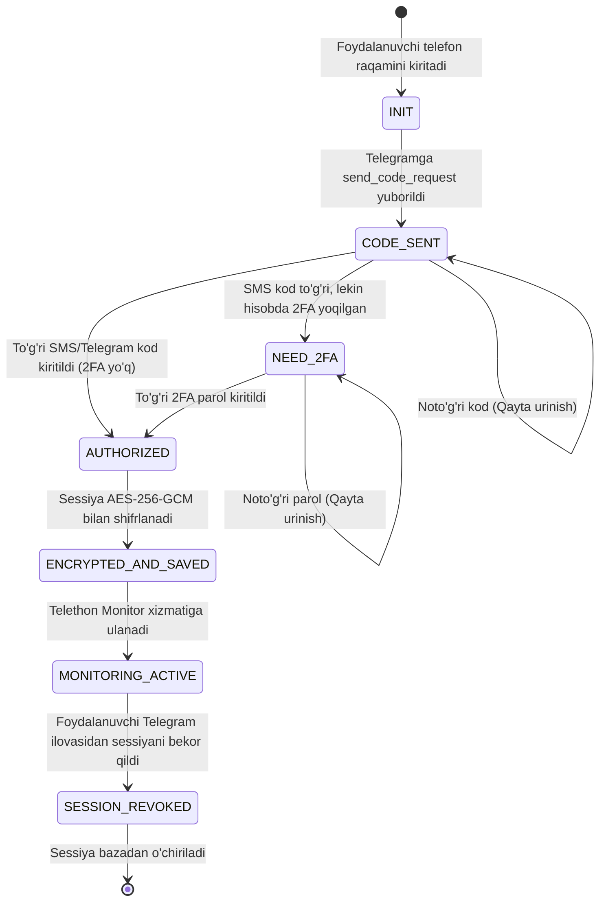

# 01. Telegram Hisobini Ulash va Avtorizatsiya (Account Authorization)

## 1. Kirish va Maqsad

Tizim Telegram kanallari va guruhlaridagi xabarlarni kuzatish uchun **Telethon** (Telegram MTProto Client) kutubxonasidan foydalanadi. Buning uchun foydalanuvchi oʻzining shaxsiy Telegram hisobini platformaga ulashi kerak.

Ushbu jarayon foydalanuvchi maxfiyligi va akkaunt xavfsizligi nuqtai nazaridan eng sezgir nuqta hisoblanadi. SMS kodlar va 2FA parollar mutlaqo xavfsiz boshqarilishi, Telethon sessiyalari esa bazaga tushishi bilan shifrlanishi shart.

---

## 2. Avtorizatsiya Holatlari Mashinasi (State Machine)

Telegram hisobini ulash koʻp bosqichli asinxron jarayon boʻlib, quyidagi holatlar (States) orqali boshqariladi:



---

## 3. Bosqichma-bosqich Avtorizatsiya Oqimi

### 1-qadam: Telefon Raqamini Yuborish (Send Code)
* Foydalanuvchi API orqali telefon raqamini yuboradi: `POST /api/v1/telegram/auth/send-code`.
* Backend vaqtinchalik Telethon mijozi yaratadi va Telegram serveriga soʻrov yuboradi:
  ```python
  client = TelegramClient(StringSession(), api_id, api_hash)
  await client.connect()
  sent_code = await client.send_code_request(phone_number)
  ```
* Telegram `phone_code_hash` qaytaradi.
* Ushbu `phone_code_hash` va vaqtinchalik sessiya maʼlumoti Redis'ga qisqa muddatli TTL (5 daqiqa) bilan saqlanadi.

### 2-qadam: Tasdiqlash Kodini Kiritish (Submit OTP Code)
* Foydalanuvchi Telegram ilovasiga kelgan 5 xonali kodni yuboradi: `POST /api/v1/telegram/auth/verify-code`.
* Backend Telegram serveriga kodni taqdim etadi:
  ```python
  try:
      await client.sign_in(phone_number, code, phone_code_hash=phone_code_hash)
  except SessionPasswordNeededError:
      # Hisobda 2FA bulutli parol yoqilgan
      return {"status": "NEED_2FA_PASSWORD"}
  ```

### 3-qadam: 2FA Bulutli Parolini Kiritish (Two-Step Verification)
* Agar hisobda 2FA oʻrnatilgan boʻlsa, foydalanuvchi parolni kiritadi: `POST /api/v1/telegram/auth/verify-2fa`.
* Telethon SRP (Secure Remote Password) protokoli orqali parolni Telegram serveriga yuboradi:
  ```python
  await client.sign_in(password=two_step_password)
  ```
* **Muhim:** Foydalanuvchining 2FA paroli hech qachon loglanmaydi va maʼlumotlar bazasiga yozilmaydi. Muvaffaqiyatli autentifikatsiyadan soʻng u xotiradan (RAM) darhol tozalanadi.

### 4-qadam: Sessiyani Shifrlash va Saqlash
* Autentifikatsiya tugagach, Telethon'dan xom sessiya qatori olinadi:
  ```python
  session_string = client.session.save()
  ```
* Bu qator ochiq holda bazaga yozilmaydi! U zudlik bilan `AES-256-GCM` orqali shifrlanadi (foydalanuvchining `user_id` si AAD sifatida bogʻlanadi) va `telegram_accounts` jadvaliga `encrypted_session` maydoniga yoziladi.
* Vaqtinchalik Redis maʼlumotlari oʻchirib yuboriladi.

---

## 4. Sessiyaning Uzilishi va Xatoliklarni Boshqarish

Agar foydalanuvchi oʻz telefonidagi Telegram ilovasidan "Settings -> Devices -> Terminate session" orqali bizning tizim sessiyasini bekor qilsa:
* Telethon mijozi navbatdagi soʻrovda `AuthKeyUnregisteredError` yoki `SessionRevokedError` xatoligini qabul qiladi.
* Tizim bu xatolikni ushlaydi:
  1. Akkaunt holatini bazada `REVOKED` deb belgilaydi.
  2. Telethon monitoridan ushbu mijozni toʻxtatadi.
  3. Foydalanuvchiga Telegram boti orqali "Sessiyangiz Telegram ilovasida bekor qilindi. Monitoringni davom ettirish uchun qayta ulaning" degan bildirishnoma yuboradi.
