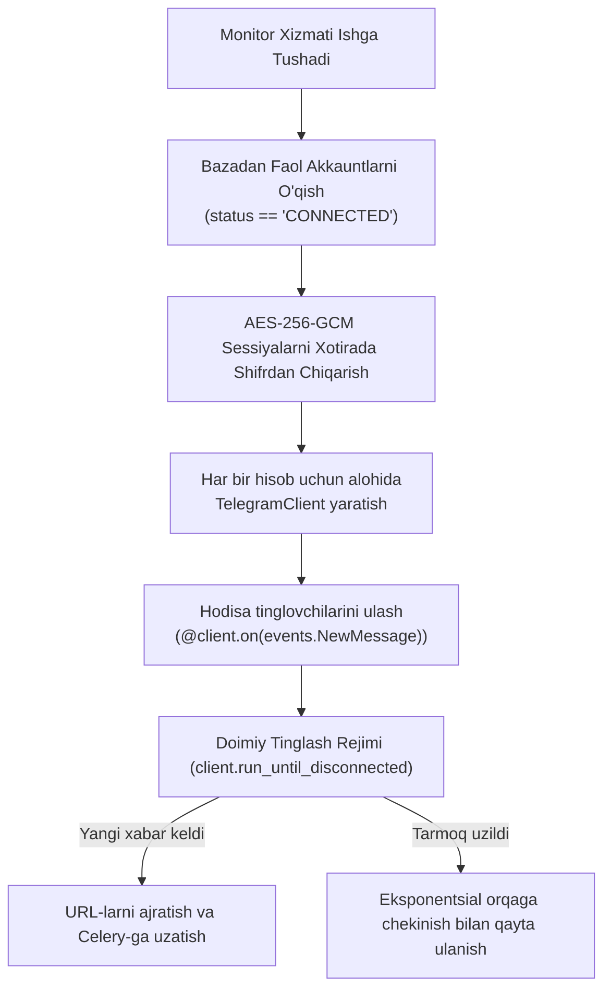

# 02. Xabarlarni Real Vaqtda Kuzatish (Telegram Monitoring Engine)

## 1. Kirish va Maqsad

Ushbu hujjat ulangan Telegram hisoblari orqali guruhlar, kanallar va shaxsiy chatlardagi yangi xabarlarni real vaqt rejimida qabul qilish, tahlil qilish va qayta ishlashga yoʻnaltirish (Monitoring Engine) arxitekturasini belgilaydi.

Telethon monitorining asosiy maqsadi: Telegram serverlariga minimal yuklama bergan holda, MTProto hodisalarini (Events) barqaror tutib olish va tizim resurslarini ortiqcha sarflamaslikdir.

---

## 2. Telethon Client Manager Hayotiy Sikli

Telethon monitor alohida mustaqil xizmat (Daemon jarayon) sifatida ishlaydi.



---

## 3. Hodisalarni Qabul Qilish va Filtrlash Qoidalari

### 3.1 Qabul Qilinadigan Hodisalar
* **`events.NewMessage`:** Yangi kelgan xabarlar.
* **`events.MessageEdited`:** Tahrirlangan xabarlar (Koʻpincha firibgarlar dastlab oddiy matn yuborib, soʻng uni fishing havolasiga oʻzgartiradilar).

### 3.2 Filtrlash va E'tibordan Chetda Qoldirish (Ignore Rules)
Resurslarni tejash maqsadida quyidagi xabarlar tahlilga yuborilmaydi:
1. **Xizmat xabarlari (Service Messages):** "Foydalanuvchi guruhga qoʻshildi", "Guruh rasmi oʻzgardi" kabi tizim xabarlari.
2. **Boʻsh yoki faqat media xabarlar:** Agar xabarda na matn va na matnli sarlavha (caption) boʻlmasa (masalan, stiker, audio fayl, dumaloq video).
3. **Havolasiz oddiy xabarlar:** Agar xabar matnida URL yoki web-entitilar mavjud boʻlmasa, u maʼlumotlar bazasiga ham yozilmaydi, zudlik bilan tashlab yuboriladi.

---

## 4. Havolalarni Ajratib Olish Texnikasi

Telegram xabarlarida havolalar 3 xil usulda berilishi mumkin:

```python
from telethon.tl.types import MessageEntityUrl, MessageEntityTextUrl

def extract_urls_from_message(message) -> set[str]:
    """Xabar entitilari va matnidan barcha havolalarni yig'ish."""
    found_urls = set()
    text = message.message or ""

    if not message.entities:
        # Entitilar bo'lmasa, ehtiyotkorona Regex tekshiruvi
        return extract_urls_via_regex(text)

    for entity in message.entities:
        # 1. Ochiq ko'rinuvchi havola: https://example.com
        if isinstance(entity, MessageEntityUrl):
            offset = entity.offset
            length = entity.length
            url = text[offset : offset + length]
            found_urls.add(url)
            
        # 2. Matn ostiga yashiringan havola: [Bosing](https://phishing.com)
        elif isinstance(entity, MessageEntityTextUrl):
            found_urls.add(entity.url)

    return found_urls
```

---

## 5. Tarmoq Uzilishlari va Qayta Ulanish (Reconnection)

Telegram MTProto serverlari vaqti-vaqti bilan ulanishni uzishi yoki server qayta yuklanishi mumkin.

* Telethon mijozi uchun avtomatik qayta ulanish logikasi:
  ```python
  client = TelegramClient(
      session=StringSession(decrypted_session),
      api_id=settings.TELEGRAM_API_ID,
      api_hash=settings.TELEGRAM_API_HASH,
      auto_reconnect=True,
      connection_retries=10,
      retry_delay=5
  )
  ```
* Agar ulanish bir necha bor muvaffaqiyatsiz boʻlsa, tizim kutish vaqtini 5s, 10s, 30s, 60s qilib eksponentsial oshiradi (Exponential Backoff).
