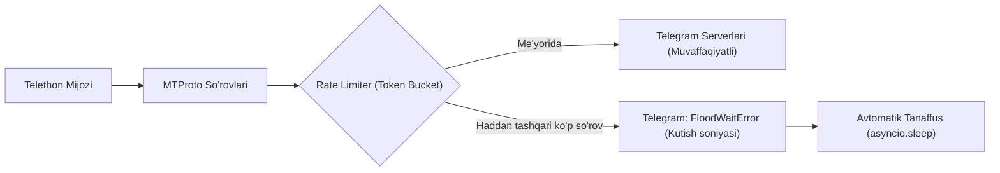

# 04. Telegram Cheklovlari va FloodWait Boshqaruvi (Limits & FloodWait Handling)

## 1. Kirish va Maqsad

Telegram platformasi foydalanuvchilar hisoblarini botlar, spam va noqonuniy skreypingdan himoya qilish maqsadida juda qatʼiy ichki cheklovlar (Rate Limits) va avtomatik jazolash mexanizmlariga ega.

Ushbu hujjat Telegram API tomonidan qoʻyiladigan cheklovlarni, `FloodWaitError` xatoliklarini xavfsiz boshqarishni hamda foydalanuvchi hisobining bloklanishiga (ban) olib keluvchi harakatlarni qatʼiy taqiqlash qoidalarini belgilaydi.

---

## 2. Asosiy Telegram Cheklovlari (Rate Limits)



1. **Guruhlar va Kanallarni Oʻqish:**
   * Yangi xabarlarni tinglash (`events.NewMessage`) Telegram tomonidan cheklanmaydi (chunki xabarni Telegram oʻzi push-xabarnoma sifatida yuboradi).
   * Lekin guruh aʼzolarini yalpi yuklab olish (`GetParticipantsRequest`) yoki oʻtmishdagi xabarlar arxivini ketma-ket yuklash juda tez `FloodWaitError` keltirib chiqaradi.
2. **Kuzatish Doirasi Cheklovlari:**
   * Ulangan foydalanuvchi hisobi faqat oʻzi aʼzo boʻlgan va unga koʻrinadigan guruh/kanallarni kuzata oladi.
   * Hisob yopiq (private) guruhlarga avtomatik aʼzo boʻla olmaydi va administrator ruxsatlarisiz yashirin xabarlarni oʻqiy olmaydi.

---

## 3. `FloodWaitError` bilan Ishlash Strategiyasi

Agar Telegram serveri soʻrovlar koʻpligi sababli `FloodWaitError` qaytarsa:

```python
from telethon.errors import FloodWaitError
import asyncio
import logging

logger = logging.getLogger(__name__)

async def safe_telegram_call(coro, max_wait_seconds: int = 300):
    """FloodWait xatoligini ushlab, avtomatik tanaffus bilan bajarish."""
    try:
        return await coro
    except FloodWaitError as e:
        wait_seconds = e.seconds
        logger.warning(f"Telegram FloodWait: {wait_seconds} soniya kutish talab etilmoqda.")
        
        if wait_seconds > max_wait_seconds:
            # Agar Telegram 5 daqiqadan ko'p kutishni so'rasa, xatolik berib to'xtatamiz
            logger.error("FloodWait kutish vaqti juda katta. So'rov bekor qilindi.")
            raise
            
        await asyncio.sleep(wait_seconds + 1)
        return await coro  # Qayta urinib ko'rish
```

---

## 4. Akkaunt Bloklanishining (Ban) Oldini Olish Qoidalari

Telegram foydalanuvchi hisoblarini bloklab qoʻymasligi uchun quyidagi harakatlar **mutlaqo taqiqlanadi**:

1. **Avtomatik Guruhlarga Qoʻshilmaslik (No Auto-Join):** Tizim hech qachon foydalanuvchi nomidan guruh yoki kanallarga avtomatik aʼzo boʻlmaydi.
2. **Xabar Yozmaslik (Read-Only Mode):** Foydalanuvchi nomidan guruhlarga ogohlantirish yoki xabar yozish taqiqlanadi. Ogohlantirishlar faqat alohida rasmiy **Telegram Bot** orqali yuboriladi.
3. **Arxivlarni Yuklamaslik:** Akkaunt ulanganda oʻtgan 1 oy yoki 1 yillik xabarlar arxivi yuklab olinmaydi.
4. **Ommaviy Profil Skreyping Qilmaslik:** Guruh aʼzolarining profillarini, rasmlarini yoki bio-matnlarini ommaviy yuklab olish taqiqlanadi.
