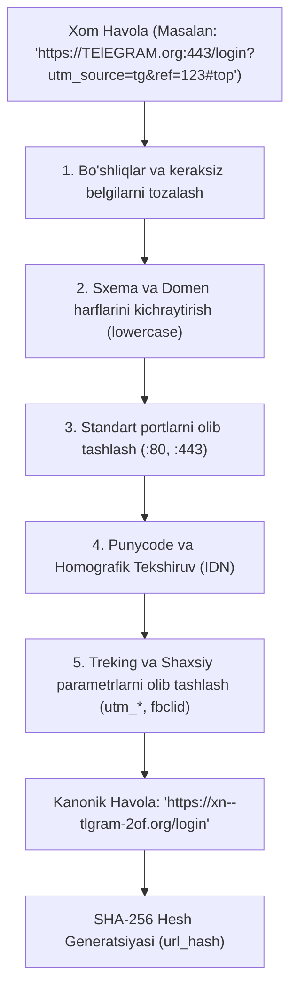

# 01. Havolalarni Ajratish va Normalizatsiya Qilish (URL Pipeline)

## 1. Kirish va Maqsad

Kiberjinoyatchilar va fishing hujumchilari oʻzlarining zararli havolalarini foydalanuvchilar va avtomatlashtirilgan xavfsizlik tizimlaridan yashirish uchun turli xil niqoblash (obfuscation) usullaridan foydalanadilar:
* Kirill va Lotin harflarini aralashtirish (Homografik hujumlar — Masalan: `tеlеgram.org`).
* URL qisqartirish xizmatlari (`bit.ly`, `tinyurl.com`, `t.me/iv?url=...`).
* IP manzillarni oʻnlik, sakkizlik yoki oʻn oltilik formatda berish (`http://2130706433/`).
* Userinfo orqali aldash (`http://google.com@phishing-target.com`).

Ushbu hujjat havolalarni xom matndan ajratib olish, ularni tozalash, normalizatsiya qilish va yagona kanonik (Canonical) koʻrinishga keltirish quvuri (Pipeline) arxitekturasini belgilaydi.

---

## 2. URL Qayta Ishlash Quvuri (Pipeline Flow)



---

## 3. Asosiy Niqoblash Usullari va Ularni Bartaraf Etish

### 3.1 IDN Homografik Hujumlari (Punycode)
* **Hujum:** Hujumchi domen nomidagi lotin `e` harfini kirillcha `е` (U+0435) bilan almashtiradi: `tеlеgram.org`. Brauzerda ular bir xil koʻrinadi, lekin xalqaro domen tizimida bu `xn--tlgram-2of.org` hisoblanadi.
* **Yechim:** Barcha domenlar standart `idna` kutubxonasi orqali ASCII Punycode formatiga oʻtkaziladi. Agar domenda bir nechta alifbo (skript) aralashmasi aniqlansa, xavf koeffitsienti avtomatik oshiriladi.

### 3.2 Userinfo Aldovi (`user:pass@host`)
* **Hujum:** `https://bank.uz@evil-phishing.com/login`. Oʻrganmagan foydalanuvchi "bank.uz" ni koʻrib ishonishi mumkin, lekin brauzer aslida `evil-phishing.com` ga ulanadi.
* **Yechim:** URL parslanganda `userinfo` qismi (`bank.uz@`) ajratib olinadi va domen aniq belgilab olinadi.

### 3.3 Muqobil IP Manzil Formatlari
* Hujumchilar oddiy `127.0.0.1` oʻrniga:
  * Oʻnlik (Dword): `http://2130706433`
  * Oʻn oltilik (Hex): `http://0x7f000001`
  * Sakkizlik (Octal): `http://017700000001`
* **Yechim:** Python'ning `ipaddress` moduli yordamida barcha sonli xostlar kanonik IPv4 formatiga keltiriladi va SSRF qora roʻyxatidan tekshiriladi.

### 3.4 Qisqartirilgan Havolalarni Yechish (Short URL Expansion)
* Agar havola `bit.ly`, `t.co`, `tinyurl.com`, `is.gd` kabi domenlarga tegishli boʻlsa:
  * Skaner SSRF himoyalangan soʻrov bilan yoʻnaltirish manzilini (`Location` sarlavhasini) oladi.
  * Haqiqiy yakuniy maqsadli havola olinadi va u tahlil qilinadi.

---

## 4. Kanonik URL va SHA-256 Hesh Yaratish

Tizimda takroriy skanerlashni oldini olish uchun har bir havola tozalangach, uning SHA-256 heshi hisoblanadi:

```python
import hashlib
from urllib.parse import urlparse, urlunparse, parse_qsl, urlencode

TRACKING_PARAMS = {"utm_source", "utm_medium", "utm_campaign", "utm_term", "utm_content", "fbclid", "gclid", "ref"}

def canonicalize_url(url: str) -> str:
    parsed = urlparse(url)
    scheme = parsed.scheme.lower()
    netloc = parsed.netloc.lower()
    
    # Standart portlarni tozalash
    if netloc.endswith(":80") and scheme == "http":
        netloc = netloc[:-3]
    elif netloc.endswith(":443") and scheme == "https":
        netloc = netloc[:-4]

    # Query parametrlarni tozalash va saralash
    query_params = parse_qsl(parsed.query)
    clean_params = [(k, v) for k, v in query_params if k.lower() not in TRACKING_PARAMS]
    clean_params.sort(key=lambda x: x[0])
    clean_query = urlencode(clean_params)

    canonical = urlunparse((scheme, netloc, parsed.path or "/", parsed.params, clean_query, ""))
    return canonical

def get_url_hash(canonical_url: str) -> str:
    return hashlib.sha256(canonical_url.encode("utf-8")).hexdigest()
```
