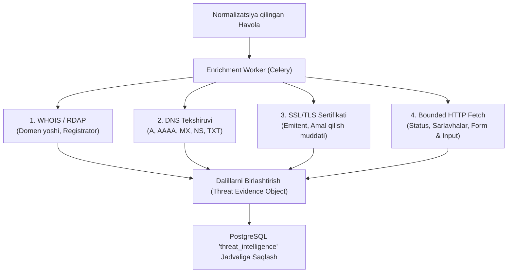

# 02. Domen, DNS va Texnik Dalillarni Toʻplash (Threat Intelligence & Enrichment)

## 1. Kirish va Maqsad

Kiberxavfsizlikda faqat sun'iy intellektga yoki faqat veb-sayt matniga tayanib xulosa chiqarish xavflidir. Fishing saytlari koʻpincha tashqi koʻrinishidan chiroyli va qonuniy koʻrinsa-da, ularning texnik infratuzilmasi (domen yoshi, DNS yozuvlari, SSL sertifikati, formalar yoʻnalishi) firibgarlikni fosh qiladi.

Ushbu hujjat havola boʻyicha obyektiv texnik dalillarni (Evidence) xavfsiz toʻplash mexanizmlarini belgilaydi.

---

## 2. Toʻplanadigan Texnik Dalillar Turlari

---

## 3. Texnik Dalillar Spetsifikatsiyasi

### 3.1 WHOIS va RDAP (Domen Yoshi)
* **Kuzatishlar:**
  * Domen roʻyxatdan oʻtgan sana (`created_date`).
  * Domen yoshi (kunlarda hisoblanadi: `domain_age_days = (today - created_date).days`).
  * Registrator nomi (`registrar`).
* **Qoida:**
  * Yangi ochilgan domenlar (ayniqsa < 14 kun yoki < 30 kun) fishing kampaniyalari uchun xarakterli hisoblanadi.
  * **Muhim xavfsizlik qoidasi:** Domen yangi ochilgani uning mutlaqo zararli ekanligini 100% anglatmaydi (yangi qonuniy startaplar ham boʻlishi mumkin). Shu sababli, domen yoshi yakuniy xulosa emas, balki shubha koeffitsientini oshiruvchi dalillardan biri sifatida qoʻllaniladi.

### 3.2 DNS Yozuvlari Tahlili
* **MX (Mail Exchange):** Agar sayt oʻzini yirik kompaniya (masalan, bank yoki Telegram) deb daʼvo qilsa-yu, lekin uning domenida pochta serveri (MX) umuman mavjud boʻlmasa, bu jiddiy shubha uygʻotadi.
* **NS (Name Servers):** Bepul va noaniq dinamik DNS provayderlari (masalan, tezkor fishing domenlari uchun ishlatiladigan bepul xizmatlar) aniqlanadi.

### 3.3 SSL / TLS Sertifikati Tahlili
* **Emitent (Issuer):** Sertifikat kim tomonidan berilgan (Let's Encrypt, Cloudflare, DigiCert, Sectigo).
* **Self-Signed:** Oʻzi imzolagan (notoʻgʻri yoki ishonchsiz) sertifikatlar xavf darajasini darhol oshiradi.
* **Muddati:** Muddati oʻtgan yoki kelajakda ochiluvchi sertifikatlar holati.

### 3.4 Cheklangan HTTP Sahifa Tahlili (Bounded Fetch)
* **Kirish formalari (`<form>`):**
  * Sahifada forma bormi?
  * Forma ichida parol kiritish maydoni (`<input type="password">`) bormi?
  * **Form Action tahlili:** Forma yuboriladigan manzil (`action="https://..."`) saytning oʻziga emas, balki boshqa nomaʼlum serverga yoʻnaltirilganmi? (Klassik credential harvesting usuli).
* **Matn Ekstraksiyasi (Clean Text):**
  * HTML teglardan tozalangan matn, sahifa sarlavhasi (`<title>`) va tavsifi (`<meta name="description">`).
  * Sun'iy intellekt tahliliga faqat dastlabki 50 KB gacha boʻlgan ixcham matn yuboriladi.
