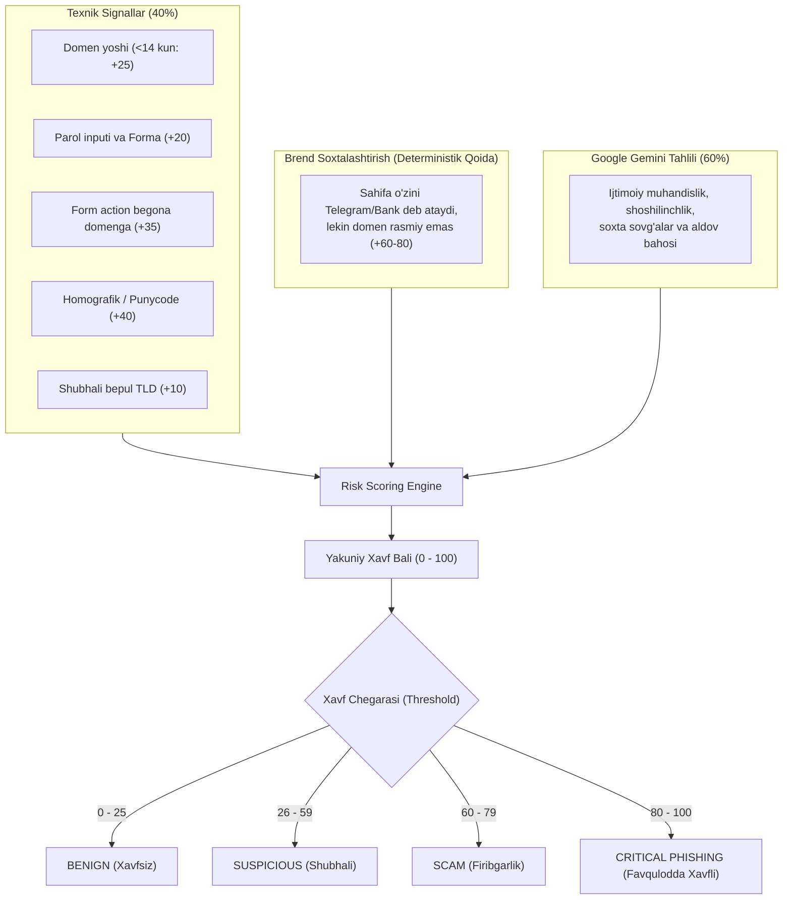

# 04. Xavf Ballarini Hisoblash Dvigateli (Risk Engine)

## 1. Kirish va Maqsad

Kiberxavfsizlikda eng muhim qoidalardan biri: **"Hech qachon faqat sun'iy intellektga yoki faqat bitta qoidaga tayanma"** tamoyilidir. AI baʼzida yangi fishing usullarini tushunmasligi (False Negative) yoki oddiy qonuniy saytni adashib xavfli deb baholashi (False Positive / Hallucination) mumkin.

Ushbu hujjat texnik dalillar (DNS, SSL, domen yoshi, formalar) va AI xulosasini birlashtiruvchi, xolis va tushuntirilishi mumkin boʻlgan (Explainable) **0 dan 100 gacha boʻlgan Xavf Ballarini (Risk Score)** hisoblash algoritmini belgilaydi.

---

## 2. Koʻp Omillik Xavf Ballari Arxitekturasi



---

## 3. Ballarni Hisoblash Qoidalari (Scoring Rules)

### 3.1 Texnik Xavf Ballari (Deterministik Indikatorlar)
* **Domen yoshi:**
  * `< 7 kun`: **+30 ball**
  * `< 14 kun`: **+20 ball**
  * `< 30 kun`: **+10 ball**
* **Kirish va Parol formalari:**
  * Sahifada `<input type="password">` bor va domen taniqli emas: **+25 ball**
  * Forma maʼlumotlari boshqa domenga yuborilmoqda (`form action != current_domain`): **+35 ball**
* **Homografik belgilar:**
  * Domenda kirill va lotin harflari aralashmasi bor: **+40 ball**
* **SSL / TLS holati:**
  * Notoʻgʻri yoki oʻzi imzolagan (Self-signed) sertifikat: **+30 ball**

### 3.2 Brendni Soxtalashtirish (Brand Impersonation Override)
Agar veb-sahifaning sarlavhasida (Title), matnida yoki logotipida taniqli brend nomi boʻlsa (masalan: *"Telegram Web", "Click.uz to'lov", "Payme kabinet", "Hamster Kombat Airdrop"*), lekin domen rasmiy roʻyxatga (`telegram.org`, `click.uz`, `payme.uz`) mos kelmasa:
* Tizim avtomatik ravishda **+60 ball** qoʻshadi va xulosa toʻgʻridan-toʻgʻri **CRITICAL_PHISHING** toifasiga koʻtariladi.

### 3.3 Gemini AI Bahosining Integratsiyasi
* Gemini bahosi (`gemini_score`: 0-100) umumiy hisobda moslashtirilgan ogʻirlik (Weight: 0.5) bilan qoʻshiladi.
* Agar texnik signallar va AI bahosi bir-birini tasdiqlasa, ishonchlilik koeffitsienti (`confidence = 0.95`) eng yuqori darajaga yetadi.

---

## 4. Tushuntiriluvchanlik va Dalillar Zanjiri (Explainable Evidence)

Tizim shunchaki "Bu sayt fishing" deb quruq xulosa chiqarmaydi. Har bir xulosa uchun foydalanuvchi va tahlilchiga aniq dalillar roʻyxati taqdim etiladi:

```json
{
  "verdict": "PHISHING",
  "risk_score": 92,
  "confidence": 0.95,
  "impersonated_brand": "Telegram",
  "reasons": [
    "Domen atigi 3 kun oldin ro'yxatdan o'tgan (yangi ochilgan).",
    "Sahifa o'zini 'Telegram Web Login' deb taqdim etmoqda, biroq domen rasmiy 'telegram.org' emas.",
    "Sahifada telefon raqami va tasdiqlash kodini kiritish formasi mavjud.",
    "Forma ma'lumotlari shubhali tashqi IP manzilga yo'naltirilgan."
  ]
}
```
