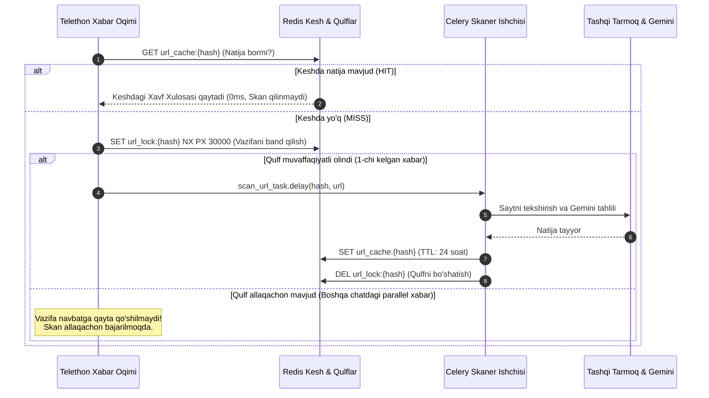

# 05. Keshlash va Takroriy Skanlarni Oldini Olish (Caching & Deduplication)

## 1. Kirish va Maqsad

Telegram'dagi koʻplab guruhlar va kanallarda bitta fishing xabari (yoki spam havola) bir vaqtning oʻzida oʻnlab yoki yuzlab chatlarga tarqatiladi. Agar har bir kelgan xabar uchun alohida tashqi HTTP soʻrovi yuborilib, Gemini API chaqirilsa:
1. Server resurslari va tarmoq trafigi behuda sarflanadi.
2. Google Gemini API kvotasi va hisob balansi bir necha daqiqada tugab qoladi.
3. Serverda bir vaqtning oʻzida yuzlab bir xil vazifalar navbati (Thundering Herd muammosi) vujudga keladi.

Ushbu hujjat **Redis** asosidagi yuqori unumdorlikka ega keshlash va vazifalarni deduplikatsiya qilish (Deduplication) arxitekturasini belgilaydi.

---

## 2. Kesh va Qulflash Arxitekturasi (Distributed Locking)

---

## 3. Redis Kalitlari Strukturasi va TTL Siyosati

| Kalit Formati | Ma'lumot Turi | TTL (Yashash Muddati) | Vazifasi |
| :--- | :--- | :--- | :--- |
| `url_cache:{url_hash}` | `JSON` | 24 - 72 soat | Skanerlangan havola boʻyicha toʻliq xulosa (Verdict, Score, Reasons) |
| `url_lock:{url_hash}` | `STRING` | 30 soniya | Parallel kelgan bir xil havolalarning bir vaqtda skan qilinishini toʻsish |
| `domain_rate:{domain}` | `INTEGER` | 1 soniya | Bitta domenga soniyasiga 1 tadan koʻp HTTP soʻrov yubormaslik (DDoS oldini olish) |
| `user_alert:{user_id}:{hash}` | `STRING` | 1 soat | Foydalanuvchiga bitta havola haqida takroriy ogohlantirish yubormaslik |

---

## 4. Dinamik Kesh Muddati (Dynamic TTL)

Barcha saytlar bir xil muddatga kes Record qilinmaydi:
* **Xavfsiz mashhur saytlar (BENIGN):** Masalan: `github.com`, `wikipedia.org`, `kun.uz` — kesh muddati **7 kun** (chunki bu saytlar tezda fishingga aylanib qolmaydi).
* **Fishing va Firibgarlik (PHISHING / SCAM):** Kesh muddati **24 soat**. Fishing saytlari bir necha soat ichida bloklanishi yoki oʻz kontentini oʻzgartirishi mumkinligi sababli, 24 soatdan soʻng qayta tekshiruvga ruxsat beriladi.
* **Xatolik bergan saytlar (UNKNOWN / TIMEOUT):** Kesh muddati **1-2 soat** (sayt vaqtincha ishlamayotgan boʻlishi mumkin, tezroq qayta tekshirish uchun).

---

## 5. Majburiy Qayta Skan Qilish (Force Rescan)

* Tizim maʼmurlari yoki xavfsizlik tahlilchilari zarurat tugʻilganda keshni eʼtiborga olmasdan qayta skan qilish buyrugʻini berishlari mumkin (`POST /api/v1/scans/rescan?force=true`).
* Bu holda Redis keshidagi `url_cache:{url_hash}` oʻchirilib, butun tekshiruv zanjiri noldan ishga tushiriladi.
