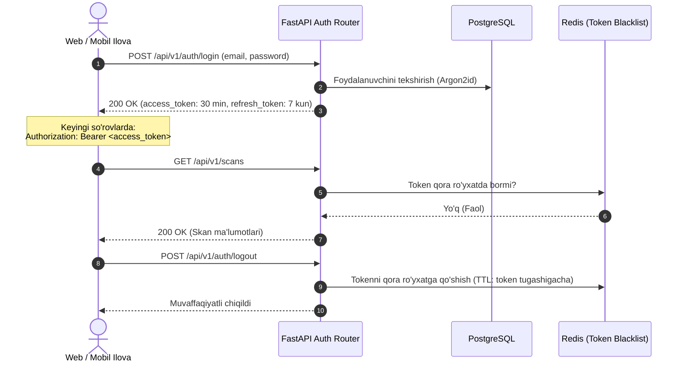

# 02. API Autentifikatsiyasi va JWT Tokenlar (API Authentication)

## 1. Kirish va Maqsad

FastAPI API barcha himoyalangan resurslar uchun zamonaviy va xavfsiz **JWT (JSON Web Token)** Bearer autentifikatsiya mexanizmidan foydalanadi.

Ushbu hujjat tokenlarni berish, yangilash, tekshirish va bekor qilish (Revocation / Blacklist) tartibini belgilaydi.

---

## 2. Autentifikatsiya Oqimi



---

## 3. JWT Token Tuzilishi va Da'volar (Claims)

Imzolangan token ichida quyidagi minimal maʼlumotlar saqlanadi:
* `sub` (Subject): Foydalanuvchining unikal UUID-si (`user_id`).
* `role`: Foydalanuvchi roli (`USER`, `ANALYST`, `ADMIN`).
* `jti` (JWT ID): Har bir token uchun takrorlanmas unikal identifikator (qora roʻyxatga kiritish uchun).
* `iat` (Issued At): Token yaratilgan vaqt tamgʻasi.
* `exp` (Expires At): Tokenning amal qilish muddati (30 daqiqa).

---

## 4. FastAPI Dependency Inyeksiyasi

Domen marshrutlarini himoya qilish uchun qulay FastAPI bogʻliqliklari (Dependencies) yaratiladi:

```python
from fastapi import Depends, HTTPException, status
from fastapi.security import HTTPBearer, HTTPAuthorizationCredentials

security = HTTPBearer()

async def get_current_user(
    credentials: HTTPAuthorizationCredentials = Depends(security),
    db: AsyncSession = Depends(get_db_session),
    redis: Redis = Depends(get_redis)
) -> User:
    token = credentials.credentials
    # 1. Redis qora ro'yxatidan tekshirish
    if await redis.get(f"token_blacklist:{token}"):
        raise HTTPException(status_code=status.HTTP_401_UNAUTHORIZED, detail="Token bekor qilingan")
    
    # 2. JWT imzosini tekshirish va user_id ni olish
    payload = verify_jwt_token(token)
    user_id = payload.get("sub")
    
    # 3. Bazadan foydalanuvchini olish
    user = await get_user_by_id(db, user_id)
    if not user or not user.is_active:
        raise HTTPException(status_code=status.HTTP_401_UNAUTHORIZED, detail="Foydalanuvchi topilmadi yoki nofaol")
        
    return user
```
