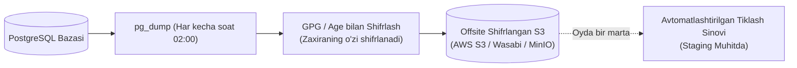

# 04. Zaxira Nusxalash va Qayta Tiklash (Backup & Disaster Recovery)

## 1. Kirish va Maqsad

Kiberxavfsizlikda eng muhim qoidalardan biri: **"Sinovdan oʻtkazilmagan zaxira nusxa (backup) mavjud emas deb hisoblanadi"**. 

Ushbu hujjat PostgreSQL maʼlumotlar bazasining doimiy zaxira nusxalarini yaratish, ularni shifrlangan holda tashqi xavfsiz xotiraga (Offsite S3) uzatish hamda server toʻliq ishdan chiqqan taqdirda tizimni noldan qayta tiklash (Disaster Recovery) rejasini belgilaydi.

---

## 2. Zaxira Nusxalash Strategiyasi



1. **Davriy Zaxiralash (Logical Backups):**
   * Har kecha soat 02:00 da `pg_dump` orqali toʻliq siqilgan zaxira nusxa olinadi.
2. **Zaxiralarni Shifrlash:**
   * Baza dump fayli yaratilishi bilan GPG kaliti orqali shifrlanadi. Shifrlanmagan SQL fayl hech qachon tarmoqqa yoki tashqi serverga uzatilmaydi.
3. **Saqlash Muddati (Retention):**
   * Kunlik zaxiralar: **14 kun**.
   * Haftalik zaxiralar: **8 hafta**.
   * Oylik arxiv zaxiralar: **6 oy**.

---

## 3. Zaxiradan Qayta Tiklash Rejasi (Disaster Recovery Runbook)

Server kutilmaganda qulab tushgan yoki baza shikastlangan taqdirda qayta tiklash bosqichlari:

### 1-qadam: Yangi Serverda Infratuzilmani Koʻtarish
```bash
docker compose up -d postgres redis
```

### 2-qadam: Shifrlangan Zaxira Faylini Yuklab Olish va Shifrdan Chiqarish
```bash
# S3 dan yuklab olish
aws s3 cp s3://my-backup-bucket/db_backup_2026_10_22.sql.gz.enc ./

# GPG orqali shifrdan chiqarish
gpg --decrypt db_backup_2026_10_22.sql.gz.enc > db_backup.sql.gz
gunzip db_backup.sql.gz
```

### 3-qadam: Bazaga Qayta Yuklash
```bash
docker compose exec -T postgres psql -U postgres -d phishing_db < db_backup.sql
```

### 4-qadam: Barcha Xizmatlarni Qayta Ishga Tushirish
```bash
docker compose up -d
docker compose logs -f
```

---

## 4. Oylik Tiklash Mashgʻuloti (Restoration Drill)

* Har oyning birinchi sanasida alohida test (Staging) muhitida eng soʻnggi zaxira nusxadan baza qayta tiklanadi va barcha testlar (`pytest`) muvaffaqiyatli oʻtishi amalda tekshiriladi.
