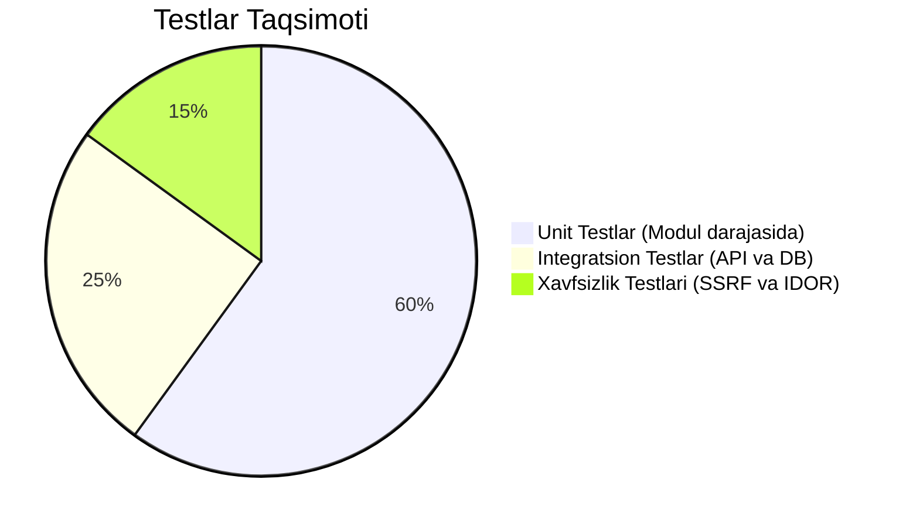

# 03. Testlash Strategiyasi va Sifat Kafolati (Testing Strategy)

## 1. Kirish va Maqsad

Kiberxavfsizlik dasturlarida testlarning yetishmasligi qabul qilib boʻlmas xatodir. Har bir xavfsizlik filtri, SSRF tekshiruvi, shifrlash algoritmi va maʼlumotlar izolyatsiyasi avtomatlashtirilgan testlar orqali isbotlanishi shart.

Ushbu hujjat loyihadagi testlar piramidasi, test turlari va ularni bajarish standartlarini belgilaydi.

---

## 2. Testlar Piramidasi



---

## 3. Test Turlari va Mas'uliyatlari

### 3.1 Unit Testlar (`tests/unit/`)
* **Vazifasi:** Tashqi tarmoqqa yoki bazaga ulanmasdan alohida funksiyalarning toʻgʻri ishlashini tekshirish.
* **Asosiy test obyektlari:**
  * **Kriptografiya:** AES-256-GCM shifrlash va shifrdan chiqarish. Agar shifromatndan 1 bayt oʻzgartirilsa, `InvalidTag` xatoligi berilishi shart.
  * **SSRF Filtr:** `127.0.0.1`, `169.254.169.254`, `10.0.0.1`, `::1` manzilari bloklanishini tekshirish.
  * **URL Normalizatsiyasi:** `tеlеgram.org` kabi homografik havolalar Punycode'ga toʻgʻri oʻtishi.
  * **Risk Engine:** Maʼlum dalillar toʻplami berilganda xavf ballari toʻgʻri hisoblanishi.

### 3.2 Integratsion Testlar (`tests/integration/`)
* **Vazifasi:** API endpointlari, Pydantic modellar va PostgreSQL bazasining birgalikda ishlashini tekshirish.
* **Asboblar:** `pytest-asyncio`, `httpx.AsyncClient`.
* **Mocking:** Tashqi Google Gemini va Telegram MTProto soʻrovlari mock qilinadi (haqiqiy tarmoqqa chiqilmaydi).

### 3.3 Xavfsizlik Testlari (`tests/security/`)
* **SSRF Sinovi:** Haqiqiy HTTP fetcher moduliga ichki IP manzillarni yuborib koʻrish va uning soʻrovni rad etishini tekshirish.
* **Anti-IDOR Sinovi:** Foydalanuvchi "A" ning JWT tokeni bilan Foydalanuvchi "B" ning skan natijalarini koʻrishga urinish va tizim `404 Not Found` qaytarishini tasdiqlash.
* **Secret Leakage:** Kod bazasida tasodifiy ochiq API kalitlar yoʻqligini tekshiruvchi test.

---

## 4. Testlarni Ishga Tushirish

```bash
# Barcha testlarni bajarish
pytest

# Batafsil hisobot va kod qoplamini (Coverage) ko'rish
pytest --cov=app --cov-report=term-missing

# Faqat xavfsizlik testlarini bajarish
pytest tests/security/
```

Kiberxavfsizlik modullari (`core/security.py`, `modules/url_scanning/ssrf.py`, `modules/risk_engine/`) uchun kod qoplami (Code Coverage) **90% dan yuqori** boʻlishi talab etiladi.
