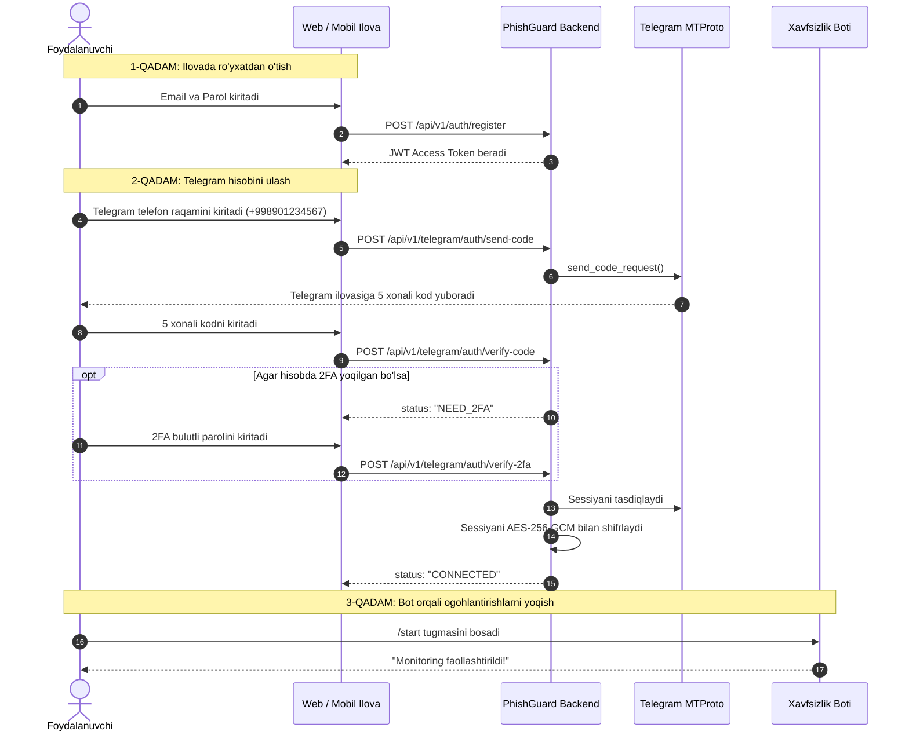

# Foydalanuvchi Kiritishi Kerak Boʻlgan Maʼlumotlar Qoʻllanmasi
## (User Input & Data Requirements Guide)

Ushbu hujjat har bir foydalanuvchi **PhishGuard** (Telegram Fishing va Firibgarlikni Aniqlash Platformasi) tizimidan foydalanishi uchun qanday maʼlumotlarni kiritishi kerakligi, bu maʼlumotlar qanday maqsadda ishlatilishi va ularning xavfsizligi qanday taʼminlanishini bosqichma-bosqich tushuntiradi.

---

## 1. Umumiy Koʻrinish (Jadval)

| Bosqich | Foydalanuvchi Kiritadigan Maʼlumot | Majburiyligi | Maqsadi | Xavfsizlik va Saqlash Usuli |
| :--- | :--- | :--- | :--- | :--- |
| **1. Roʻyxatdan oʻtish** | **Email** | Majburiy | Tizimga kirish va hisob identifikatori | Ochiq holda (unikal indeks bilan) |
| | **Parol** (Platforma paroli) | Majburiy | Akkauntni himoyalash | **Argon2id** kriptografik heshi (ochiq saqlanmaydi) |
| **2. Telegram ulash** | **Telefon raqami** | Majburiy | Telegramdan kirish kodi (OTP) soʻrash | Xotirada tekshirilib, bazada **SHA-256** heshi saqlanadi |
| | **Tasdiqlash kodi (OTP)** | Majburiy | Telegram hisob egaligini tasdiqlash | Bir martalik (Redis 5 min), bazaga **saqlanmaydi** |
| | **2FA Bulutli Parol** | *Ixtiyoriy* (faqat hisobida 2FA yoqilgan boʻlsa) | Telegram Two-Step Verification tasdiqlash | **HECH QACHON SAQLANMAYDI**, RAM-da ishlatilib darhol oʻchiriladi |
| **3. Ogohlantirishlar** | **Telegram Botga /start** | Majburiy (1 marta) | Shaxsiy ogohlantirishlarni qabul qilish | Telegram Chat ID saqlanadi |

---

## 2. Bosqichma-bosqich Foydalanuvchi Jarayoni



---

## 3. Har bir Bosqichning Batafsil Tushuntirilishi

### 1-Bosqich: Platformaga Roʻyxatdan Oʻtish (Platform Auth)
Foydalanuvchi dastur veb-saytida yoki mobil ilovasida oʻz kabinetini yaratadi:
- **Kiritiladigan maydonlar:**
  1. `email`: Foydalanuvchining elektron pochta manzili (masalan: `user@example.com`).
  2. `password`: Tizim uchun yangi maxfiy parol (kamida 8 ta belgi).
- **Qanday saqlanadi?**
  Parol ochiq holda emas, sanoat standarti boʻlgan **Argon2id** algoritmi orqali bir tomonlama heshlanadi. Backend xodimlari ham parolni koʻra olmaydi.
- **Natija:**
  Foydalanuvchiga xavfsiz **JWT Access Token** va **Refresh Token** beriladi.

---

### 2-Bosqich: Telegram Hisobini Himoyaga Ulash (Telegram Connect)
Guruh va kanallardagi fishing havolalarni tutib olish uchun foydalanuvchi oʻz Telegram hisobini monitoringga ulaydi:

#### 2.1. Telefon raqami
- **Kiritiladi:** Xalqaro formatdagi telefon raqami (masalan: `+998901234567`).
- **Nima sodir boʻladi?** Backend Telethon orqali Telegram rasmiy serveriga ulanadi va ushbu raqamga rasmiy tasdiqlash kodini joʻnatadi.

#### 2.2. Tasdiqlash kodi (OTP SMS / Telegram Code)
- **Kiritiladi:** Telegram ilovasiga rasmiy `Telegram Notifications` xizmatidan kelgan 5 xonali kod (masalan: `48291`).
- **Nima sodir boʻladi?** Kod Telegramga taqdim etiladi. Agar hisobda qoʻshimcha parol boʻlmasa, sessiya darhol tasdiqlanadi.

#### 2.3. 2FA Bulutli Paroli (Two-Step Verification Password)
- **Kiritiladi:** *Faqat foydalanuvchi oʻz Telegram sozlamalarida "Two-Step Verification" (ikki bosqichli bulutli parol) yoqqan boʻlsa soʻraladi.*
- **XAVFSIZLIK QOIDASI:** Foydalanuvchining 2FA paroli **hech qachon maʼlumotlar bazasiga yozilmaydi, loglarda saqlanmaydi va hech kimga koʻrinmaydi**. U xotirada (RAM) Telegramning xavfsiz SRP (Secure Remote Password) protokoli orqali Telegram serveriga uzatiladi va darhol xotiradan butunlay oʻchiriladi.

#### 2.4. Sessiya qanday saqlanadi?
Muvaffaqiyatli kirilgach, hosil boʻlgan Telethon sessiyasi **AES-256-GCM** authenticated envelope encryption orqali shifrlanadi. Shifrlash kalitiga qoʻshimcha ravishda foydalanuvchining unikal `user_id` si **AAD (Associated Authenticated Data)** sifatida bogʻlanadi. Yaʼni boshqa foydalanuvchi yoki begona odam bazani oʻgʻirlagan taqdirda ham sessiyani ocholmaydi.

---

### 3-Bosqich: Telegram Xavfsizlik Botini Faollashtirish (Bot Alert Activation)
- **Nima qilinadi?** Foydalanuvchi tizimning rasmiy Telegram botiga kirib (masalan: `@PhishGuard_Bot`), pastdagi **"Start"** tugmasini bosadi.
- **Maqsadi:** Guruh yoki kanallarda biror xavfli fishing havola aniqlanganda, bot foydalanuvchiga zudlik bilan shaxsiy xabar (DM) yuborishi uchun Telegram bot bilan shaxsiy chat ochilgan boʻlishi shart.

---

## 4. Tizim HECH QACHON Qanday Maʼlumotlarni Soʻramaydi?

Foydalanuvchi xavfsizligi va maxfiyligi nuqtai nazaridan:
- ❌ **Bank kartalari raqamlari yoki CVV kodlari** soʻralmaydi.
- ❌ **Pasport yoki shaxsni tasdiqlovchi hujjatlar** soʻralmaydi.
- ❌ **Eski yozishmalar arxivi (chatlar tarixi)** yuklab olinmaydi va saqlanmaydi.
- ❌ **Telegramdagi maxfiy yozishmalar (Secret Chats)** oʻqilmaydi.
- ❌ **Telefon kontaktlari** (agar foydalanuvchi alohida ruxsat bermasa) yuklab olinmaydi.

---

## 5. Frontend / Mobil Ilova Uchun API Soʻrovlar Misoli

Dasturchilar frontend qismida foydalanuvchidan maʼlumotlarni olib, backendga yuborishda quyidagi sodda JSON formatlardan foydalanadilar:

### 1. Roʻyxatdan oʻtish:
`POST /api/v1/auth/register`
```json
{
  "email": "alisher@gmail.com",
  "password": "MeningKuchliParolim123!"
}
```

### 2. Telegram kod soʻrash:
`POST /api/v1/telegram/auth/send-code`
```json
{
  "phone_number": "+998901234567"
}
```
*Javob: `{ "phone_code_hash": "a1b2c3d4..." }` qaytariladi.*

### 3. Telegram kodni tasdiqlash:
`POST /api/v1/telegram/auth/verify-code`
```json
{
  "phone_number": "+998901234567",
  "phone_code_hash": "a1b2c3d4...",
  "code": "72914"
}
```

### 4. Agar 2FA soʻralsa:
`POST /api/v1/telegram/auth/verify-2fa`
```json
{
  "phone_number": "+998901234567",
  "password": "telegram_2fa_paroli"
}
```

---

## 6. Foydalanuvchi Istalgan Vaqtda Akkauntni Uzishi Mumkinmi?

**Ha!** Foydalanuvchi ilovadagi "Akkauntni uzish" (`DELETE /api/v1/telegram/accounts/{id}`) tugmasini bossa:
1. Backend Telegram serveriga ulanadi va rasmiy `client.log_out()` komandasini yuboradi.
2. Natijada Telegram ilovasida "Faol seanslar" roʻyxatidan tizim seansi butunlay bekor qilinadi.
3. Shifrlangan sessiya maʼlumotlar bazasidan butunlay oʻchirib tashlanadi.
